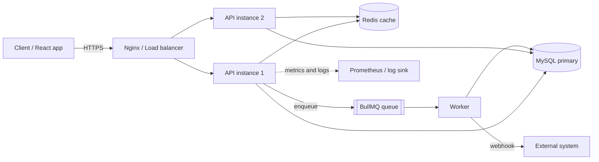
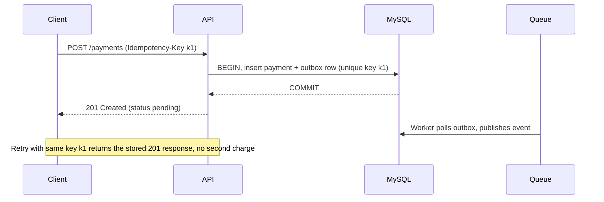

# 20 - Resume, Portfolio, GitHub, Applications and the Interview Loop

> Part 20 of the interview-prep set. Career-side companion to the technical parts (00-19).
> Audience: an experienced FRONTEND developer (React + JavaScript) moving to Node.js BACKEND roles
> in India-based product/services companies and remote roles.

**Where this fits**

| Item | Detail |
|------|--------|
| Roadmap days | Days 89-90 "Prepare for interviews" (Portfolio, Resume, Mock interview loop) in `90-day-backend-engineer-roadmap.md`; on the realistic plan this is Days 131-140 |
| Builds on | Part 08 (mock sets 1-4, readiness assessment, two STAR stories), Part 12 (Task API), Part 16 (Chaos Lab), Part 17 (Payments capstone), Part 18 (URL shortener) |
| Does NOT repeat | The technical mock questions and model answers in Part 08. Here you get the career wrapper: story, resume, repos, applications, loop tactics, behavioural bank, calendar |
| Time | About 14-18 hours of focused work, then a 30-day application loop that runs alongside your technical practice |
| Tags | `[ESSENTIAL]` = needed for almost every application; `[ADVANCED]` = polish that helps at competitive companies |

**Rules for this file**

- Everything below is a TEMPLATE or a generic example. Employer names, numbers, and company
  names are placeholders (`[Company A]`, `[X]%`). Replace them with YOUR real facts. Never put
  a number on a resume that you cannot explain and defend in an interview. An invented metric is
  the fastest way to fail a deep-dive round.
- Nothing here guarantees an offer. Market, role, competition and luck matter. This file removes
  avoidable mistakes; it does not remove uncertainty.
- Nothing in this part has code to execute; checks done were formatting only (see "Not verified" at the end).

---

## Module 1 - Positioning the transition story `[ESSENTIAL]`

**Goal:** In 2 minutes you can explain WHY you are moving, WHAT you bring, and WHAT proof you have,
without sounding like you are escaping frontend or apologising for lack of backend years.

### Concept

Recruiters and hiring managers see a frontend developer applying to backend roles and silently
ask three questions:

1. Is this person serious, or just chasing a trend / salary bump?
2. Can they actually do backend work, or only talk about it?
3. Will they stay, or leave when a frontend role shows up?

Your story must answer all three before they ask. Structure: **Past (credibility) -> Pivot (reason) ->
Proof (evidence) -> Future (what you want here).**

### Why it matters

Most rejected career-changers fail at the story stage, not the technical stage. "I wanted to learn
backend" is weak. "I kept hitting limits in how APIs were designed, so I started owning the layer
behind the UI, and here is what I built" is strong because it shows motive plus evidence.

### The four ingredients

| Ingredient | What to say | Evidence to attach |
|------------|-------------|--------------------|
| Credibility | N years shipping production web apps in React/JS to real users | Scale you touched: users, pages, team size (only real numbers) |
| Pivot reason | A pull toward the backend, not a push away from the frontend | A concrete moment: slow endpoint, painful API contract, a bug that crossed the boundary |
| Proof | You already did backend work, formally or informally | Task API, URL shortener, payments capstone, chaos lab (Parts 12, 16, 17, 18) |
| Direction | The role you want and why this company | One specific thing about their product/stack |

### The 2-minute pitch (template)

Fill the brackets with your real facts. Speak it, do not read it. Time it: 250-300 words.

```text
TEMPLATE -- 2-minute "tell me about yourself" for a frontend -> Node backend move

[PAST, 30 sec]
"I am a software engineer with [N] years of experience, mostly building production web
applications in React and JavaScript. At [Company A, or 'my current company'] I worked on
[product type, e.g. a B2B dashboard / a consumer marketplace], owned [feature area], and
worked daily with [backend team / our own Node services]."

[PIVOT, 30 sec]
"Over time I noticed that the problems I found most interesting were on the other side of the
network call: [one real example -- e.g. why a list endpoint was slow, how retries caused
duplicate orders, how we versioned an API without breaking the app]. I started reading
backend code, fixing small API issues, and then deliberately built that skill set."

[PROOF, 45 sec]
"Over the last [X] months I built [Project 1: a task management API with auth, RBAC and tests],
[Project 2: a URL shortener with Redis caching and rate limiting], and [Project 3: a payments
backend with idempotency keys, a transactional outbox and a background worker]. I also ran a
small chaos lab on it -- killed Redis, exhausted the DB pool, sent duplicate requests -- and
documented what broke and how I fixed it. The repos are on my GitHub with architecture
diagrams and decision records."

[FUTURE, 15 sec]
"I am looking for a Node.js backend role where I can own APIs end to end, and where my
frontend background helps -- I know what a good API feels like from the consumer side. I was
drawn to [Company B] because [one specific, true reason]."
```

### How to frame frontend experience as an ASSET (not a gap)

Frontend experience is not "unrelated years". Map it explicitly:

| Frontend skill you already have | Backend value | How to say it |
|---------------------------------|---------------|---------------|
| Consumed REST/GraphQL APIs for years | You know what bad APIs cost consumers | "I design error shapes, pagination and versioning the way I wish APIs had been designed for me" |
| Debugging in browser devtools, network tab | Request lifecycle, headers, caching, CORS, cookies | "CORS, cookies and cache headers are things I debugged from the client side first" |
| Performance work (bundle size, waterfalls, Core Web Vitals) | Latency budgets, N+1 calls, payload size, caching | "I think in terms of end-to-end latency, not only server time" |
| State management, optimistic updates, race conditions | Idempotency, retries, eventual consistency | "Double-submit and stale responses are frontend problems that need backend answers (idempotency keys)" |
| Deep JavaScript (closures, async, event loop) | Node runtime is the same language | "Event loop and async are not new to me; libuv and thread pool were the new layer" |
| Component thinking, testing with RTL/Jest | Modular design, testing discipline | "I already write tests; I added Supertest and DB integration tests" |
| Working with designers, PMs, backend peers | Cross-functional communication | "I can translate between product, UI and service constraints" |
| Auth flows in the UI (tokens, refresh, redirects) | Token design, session security | "I have implemented the client half of refresh-token rotation; now I built the server half" |

React analogy (use sparingly, one line is enough): a controller+service+repository split on the
backend is the same instinct as container/presentational components -- keep each layer's
responsibility narrow so it can change independently.

### Interview answer: "Why are you moving from frontend to backend?"

**Interview answer:** "It is a deliberate move, not an escape. For [N] years I built React
applications and I kept being drawn to the problems behind the API: latency, data consistency,
failure handling. I began fixing API issues at work, then spent [X] months building backend
projects from scratch -- an authenticated task API, a URL shortener with caching, and a payments
service with idempotency and a background worker -- and I wrote up the trade-offs. I am not
leaving frontend because I dislike it; I want my next role to be where I own the service layer,
and my frontend background means I understand the consumer of what I build."

### Follow-ups with answers

**Q: Will you leave when a frontend role appears?**
A: "No. I made this switch after building and testing the skill set, and I want to be judged on
backend work. If a role mixes both I enjoy that, but my target is service ownership."

**Q: You have [N] years, but no backend years. Why should we pay mid-level?**
A: "I am not claiming production backend seniority. I am claiming strong JavaScript, API-consumer
and whole-product experience plus demonstrated backend fundamentals. I am open to a level that
matches the backend evidence, and I expect to grow into the rest quickly." (Honest framing wins
trust; see Module 11.)

**Q: What if the role is purely backend with no React?**
A: "That is exactly what I am looking for. I am happy to not touch the UI."

### Common mistakes

- Apologising ("I only have frontend experience, but..."). State facts, no apology.
- Saying frontend is boring or dead. Insulting your old craft signals poor judgment.
- Listing technologies instead of telling a story with a reason and evidence.
- Overclaiming ("I am a backend engineer with 6 years"). Interviewers probe and you lose credibility.
- Having no concrete pivot moment. Prepare ONE true story.

### Revision notes

- Past -> Pivot -> Proof -> Future, 2 minutes, with a real pivot moment.
- Convert each frontend skill into a backend benefit using the table.
- Never claim production backend years you do not have.

### Key concepts to remember

1. The story answers: serious? capable? staying?
2. Pivot reason must be a pull toward backend, not a push away from frontend.
3. Evidence beats claims: link repos, diagrams, ADRs.
4. Frontend years are an asset when mapped to API design, performance, debugging, auth.
5. Honesty about level is a strength.

### Revision questions

1. Say your 2-minute pitch aloud and time it. Under 2:15?
2. What is your single true "pivot moment"?
3. Name three frontend skills and the backend benefit of each.
4. What do you say when asked "why not stay in frontend"?
5. Which claim in your pitch would you struggle to defend under follow-up? Remove it.

### Practical task (45 min)

Write your pitch in the template, record yourself on your phone, listen back, and cut every filler
word and every claim you cannot prove. Re-record. Keep the final 3 versions: 30-second (recruiter
call), 2-minute (interview), 5-minute (hiring manager chat, adds one project story).

### Checklist

- [ ] Pitch written with real facts, no apology language
- [ ] Pivot moment chosen and true
- [ ] 30s / 2min / 5min versions recorded
- [ ] Frontend-to-backend mapping table personalised (at least 5 rows)
- [ ] Can answer the three follow-ups above without notes

---

## Module 2 - Resume: structure, impact-first bullets, what to cut `[ESSENTIAL]`

**Goal:** A one-page (two pages only if 8+ years) ATS-friendly resume that reads as "backend-capable,
with strong product engineering background", not "frontend dev with a side project".

### Concept

A resume is not a biography. It is a search-and-skim document. Two readers:

1. An ATS or recruiter keyword filter (seconds): needs the right words in plain text.
2. A hiring manager (about 30-60 seconds first pass): needs impact, scope, and proof of backend depth.

### Why it matters

For a transition, ordering is a lever. Put backend evidence ABOVE the fold: a headline, a skills block
that leads with Node/SQL/Redis, and a Projects section placed before or immediately after Experience
when your backend work is mostly in projects.

### Recommended structure (one page)

| Order | Section | Rule |
|-------|---------|------|
| 1 | Header | Name, city (and "open to relocate / remote"), phone, email, GitHub, LinkedIn, deployed demo link. No photo, no DOB, no address, no father's name |
| 2 | Headline + 2-line summary | "Software Engineer -- Node.js, REST APIs, MySQL, Redis | 6 yrs in React/JS product engineering". Two lines max |
| 3 | Skills (2-3 lines) | Backend first. Group: Backend, Data, Infra/Tooling, Frontend. No skill bars, no "MS Office" |
| 4 | Backend projects OR Experience (swap based on strength) | If your job had little backend, projects go first; otherwise experience first |
| 5 | Experience | Reverse chronological, 3-5 bullets per recent role, 1-2 for old roles |
| 6 | Education + certifications | One line each. Only relevant certs |
| 7 | Optional: Open source, talks, writing | Only if real and relevant |

### Impact-first bullet formula

```text
[Strong verb] + [what you built/changed] + [how: tech / approach] + [measurable result] (+ [trade-off])

Weak:   "Responsible for API integration in the dashboard."
Strong: "Cut dashboard load time from 4.2s to 1.6s by batching 9 API calls into one aggregated
         endpoint and adding response caching (ETag + 60s Redis TTL); accepted 60s staleness."
```

Rules:

- **Start with a verb**: Built, Designed, Reduced, Migrated, Automated, Introduced, Owned, Debugged.
  Avoid "Responsible for", "Worked on", "Helped with", "Involved in".
- **One idea per bullet**, 1-2 lines. Longer than two lines will not be read.
- **Before/after metric** when possible: latency, error rate, cost, build time, conversion, support
  tickets, deploy frequency. State the baseline: "from X to Y".
- **Scope**: users, requests per day, team size, data volume. Only if true and defensible.
- **Name the trade-off** when it fits: it signals seniority (see roadmap: "name the trade-offs you made").
- **No metric available?** Use scope or outcome words honestly: "for 3 internal teams", "eliminated a manual
  weekly process", "replaced X with Y". Never invent a percentage.

### How to find metrics you forgot

| Where | What to look for |
|-------|------------------|
| Browser devtools / Lighthouse history | Load time, LCP, payload size, request count before and after |
| Analytics dashboards | Conversion, bounce, error rate on a flow you changed |
| Bug tracker | Count of tickets in an area before and after your fix |
| CI logs | Build/test time before and after |
| Cloud billing | Cost change from your optimisation |
| PR descriptions | You probably wrote "reduced from X to Y" once |
| Your own load test | Run k6/autocannon on your project and record rps / p95 before and after |

For projects (Parts 12, 16, 17, 18): run a load test before and after one optimisation and record the real
numbers in the README. Those are legitimate, defensible metrics.

### ATS keywords `[ESSENTIAL]`

ATS and recruiter searches are mostly literal string matches. Use the exact wording from the job
description where it is true for you. Common backend/Node terms (use only those you can discuss):

| Group | Keywords |
|-------|----------|
| Language/runtime | Node.js, JavaScript, TypeScript, ES6+, async/await, event loop, npm |
| Frameworks | Express.js, NestJS, Fastify (only if you used them) |
| API | REST, RESTful API, API design, OpenAPI/Swagger, GraphQL (if used), webhooks, pagination, rate limiting, versioning |
| Data | MySQL, PostgreSQL, MongoDB, SQL, query optimisation, indexing, transactions, schema design, ORM (Sequelize/Prisma/TypeORM/Mongoose) |
| Caching/queues | Redis, caching, BullMQ, RabbitMQ, Kafka (only if used), message queue, background jobs |
| Auth/security | JWT, OAuth2, RBAC, bcrypt, authentication, authorization, OWASP, input validation |
| Testing | Jest, Vitest, Supertest, unit testing, integration testing, TDD (only if you do it) |
| Infra | Docker, CI/CD, GitHub Actions, AWS (EC2, S3, RDS, SQS), Linux, Nginx, PM2, Git |
| Practices | microservices, modular monolith, system design, logging, monitoring, observability, idempotency, scalability, agile, code review |
| Soft/process | cross-functional, mentoring, ownership, on-call (only if real) |

ATS formatting rules: single column, standard headings ("Experience", "Education", "Skills",
"Projects"), real text not images, no tables/text boxes for core content, PDF or DOCX as the job
asks, file name `FirstName_LastName_Resume.pdf`, no icons for contact details (write the URL), no headers/footers
holding critical info.

### What to cut

| Cut | Why |
|-----|-----|
| Objective statement ("seeking a challenging position...") | Wasted line; replace with a headline |
| Skill percentage bars / ratings | Meaningless and unverifiable |
| Every frontend library you ever touched (Redux Saga, Enzyme, Bootstrap 3...) | Dilutes the backend signal. Keep 1 short "Frontend" line |
| Duty lists ("attended daily standups") | Not impact |
| Tutorial clones with no twist (todo app, weather app) | Replace with real projects from this repo set |
| Photo, DOB, marital status, full address, religion | Not needed; privacy and bias risk |
| Jobs older than 10-12 years (compress to one line) | Space |
| "References available on request" | Assumed |
| Buzzword soups ("passionate, hardworking, team player") | No evidence |
| Typos, inconsistent tense and date formats | Read aloud; use one date format throughout |
| Non-ASCII fancy bullets/icons if you submit as plain-text forms | Can break parsers |

### Frontend experience on a backend resume

- Keep the best frontend achievements but REPHRASE toward the system: API contracts, performance,
  reliability, auth, data flow. Example: not "Built 40 React components" but "Defined the
  API contract with backend and cut client-visible errors by..."
- Show any backend-adjacent work at your job even if informal: BFF layer, Node scripts, CI pipelines, mock servers,
  serverless functions, migrations, reporting jobs, webhooks handlers, Express middleware, SSR/Next.js API routes.
- Label honestly. "Full-stack" is acceptable only if you did own server code at work.

### Interview answer: "Walk me through your resume."

**Interview answer:** "I will follow the page top to bottom. [Role 1, most recent]: I led [area],
shipped [impact], and the part most relevant here is [API/performance/auth work]. [Role 2]: ... Then
my projects: the payments backend is the one I would like to go deep on because it covers idempotency,
transactions and a worker. I can go into any bullet."

Be ready to expand EVERY bullet for 3 minutes. If you cannot, delete it.

### Common mistakes

- Resume says "expert in Kafka" but only used it in a tutorial. Interviewers will ask about partitions.
- All bullets are tasks, none are results.
- Two-page resume with half a page of frontend library lists.
- Skills section lists 40 technologies. Aim for 15-20 you can discuss.
- Using "we" everywhere. State what YOU did, then say team context.

### Revision notes

- Impact-first: verb + what + how + result (+ trade-off).
- Backend keywords early; match the job description's words truthfully.
- Cut anything you cannot defend for 3 minutes.

### Key concepts to remember

1. Two readers: filter (keywords) and human (impact).
2. Order sections to put backend evidence above the fold.
3. Every metric needs a baseline and must be defensible.
4. Cutting is as valuable as adding.
5. Projects built in this repo are legitimate, metric-generating experience if you measure them.

### Revision questions

1. Rewrite your weakest bullet using the formula.
2. Which bullets have no verb at the start?
3. Which metric on your resume could you not explain if asked "how did you measure that"?
4. How many skills are listed? Which five would you cut?
5. Does your headline contain the words "Node.js" and "REST"?

### Practical task (90 min)

Collect your 8-10 strongest facts (with metrics), write 12 candidate bullets, rank them, keep the
best 8-10 across all roles. Send the resume to one friend and ask them to underline anything unclear.
Then do a "defend each bullet" pass aloud.

### Checklist

- [ ] One page (or two if 8+ years), single column, PDF
- [ ] Headline mentions Node.js backend and years
- [ ] Skills block is backend-first and under 20 items
- [ ] Each bullet starts with a verb, has a result or scope
- [ ] Zero invented numbers
- [ ] File named `FirstName_LastName_Resume.pdf`

---

## Module 3 - Bullet rewrite bank (weak to strong) and one-page template `[ESSENTIAL]`

**Goal:** Learn the rewrite pattern from 28 examples, then adapt them to your own real work.

**READ THIS FIRST:** every number below is an ILLUSTRATIVE PLACEHOLDER. `[X]`, `[Y]` mean "your real
value". Do not copy a bullet whose facts did not happen to you. Use the pattern, not the numbers.

### Concept

Weak bullets describe activity. Strong bullets describe a problem, an action with a technical
mechanism, and an outcome. When you do not have the metric, keep the mechanism and the scope and drop
the percentage.

### Group A - Rewriting frontend work toward backend value

| # | Weak (typical) | Strong (template, adapt facts) |
|---|----------------|--------------------------------|
| 1 | Worked on integrating APIs in the React dashboard | Reduced dashboard load from [X]s to [Y]s by replacing [N] sequential API calls with one aggregated endpoint contract agreed with the backend team |
| 2 | Responsible for API error handling on the frontend | Designed a consistent error envelope (`code`, `message`, `requestId`) with the backend team, cutting "unknown error" support tickets by [X]% |
| 3 | Fixed bugs related to API data | Traced [N] recurring data bugs to missing server-side validation; added schema validation (zod) at the API boundary and removed the whole bug class |
| 4 | Implemented login in the app | Implemented access/refresh token rotation on the client and documented the server contract, ending forced logouts that affected [X]% of sessions |
| 5 | Optimised the app performance | Cut p95 page-ready time from [X]s to [Y]s by moving N+1 fetches into a paginated list endpoint with server-side filtering and cache headers (ETag) |
| 6 | Handled duplicate form submissions | Eliminated duplicate orders by sending an `Idempotency-Key` header from the client and enforcing it on the server; duplicate-order tickets dropped from [X]/month to [Y] |
| 7 | Built a Node script for data migration | Wrote a batch migration (cursor-based, resumable, parameterised SQL) that moved [N] records with zero downtime and a verified row-count reconciliation |
| 8 | Worked with the backend team | Led API contract reviews using OpenAPI; found [N] breaking changes before release and set up contract checks in CI |

### Group B - Backend and API work (at job or in projects)

| # | Weak | Strong |
|---|------|--------|
| 9 | Created REST APIs using Node and Express | Built [N] REST endpoints in Express 5 with layered controller/service/repository structure, request validation and centralised error handling; [X]% test coverage on service layer |
| 10 | Used MySQL for the database | Designed a normalised MySQL schema with composite indexes matched to query patterns; reduced a key list query from [X]ms to [Y]ms (verified with EXPLAIN) |
| 11 | Added caching | Introduced cache-aside with Redis (TTL + explicit invalidation on write), raising cache hit rate to [X]% and cutting DB reads by [Y]%; documented the staleness trade-off |
| 12 | Implemented JWT authentication | Implemented signup/login with bcrypt, short-lived JWT access tokens, rotating refresh tokens stored hashed, and role-based access control across [N] roles |
| 13 | Added rate limiting | Added Redis-backed sliding-window rate limiting per API key and per IP, returning `429` with `Retry-After`; absorbed a [X]x burst in a load test without DB saturation |
| 14 | Wrote background jobs | Moved email and report generation to a BullMQ worker with retries, exponential backoff and a dead-letter queue; request latency fell from [X]ms to [Y]ms and failed jobs became visible and replayable |
| 15 | Handled payments | Built a payments flow with idempotency keys, a transactional outbox and webhook signature verification; a double-submit test produced exactly one charge across [N] concurrent requests |
| 16 | Wrote tests | Added Vitest + Supertest integration tests against a real MySQL container in CI; caught [N] regressions before merge and cut release rollback incidents from [X] to [Y] |
| 17 | Dockerised the app | Containerised the API and dependencies with multi-stage Docker builds and Compose, bringing local setup from [X] hours to one command and image size from [X]MB to [Y]MB |
| 18 | Set up CI/CD | Built a GitHub Actions pipeline (lint, test, build, deploy) that reduced deploy time from [X] min to [Y] min and made every merge deployable |
| 19 | Improved database performance | Replaced OFFSET pagination with keyset pagination on a [N]-row table, keeping p95 flat at [Y]ms for deep pages (previously [X]ms at page 500) |
| 20 | Fixed production issues | Diagnosed a connection-pool exhaustion incident using logs and `SHOW PROCESSLIST`; fixed an un-released connection in an error path and added pool metrics and an alert |

### Group C - Reliability, observability, ownership, collaboration

| # | Weak | Strong |
|---|------|--------|
| 21 | Added logging | Introduced structured JSON logging (pino) with correlation IDs propagated through requests and jobs, cutting mean time to diagnose incidents from [X] to [Y] |
| 22 | Did load testing | Load-tested the API with k6 at [N] rps, found the bottleneck (missing index + sync bcrypt on the loop), fixed both, and raised sustainable throughput from [X] to [Y] rps |
| 23 | Did chaos testing | Ran a chaos lab (killed Redis, throttled MySQL, injected timeouts); fixed [N] failure modes, added timeouts/circuit-breaking and graceful shutdown, and recorded results in the README |
| 24 | Wrote documentation | Authored OpenAPI docs and [N] ADRs for key decisions (cache-aside, outbox, queue choice); new teammates ran the service locally in under [X] minutes |
| 25 | Mentored juniors | Mentored [N] engineers through code reviews and a weekly design clinic; two moved to owning their own modules |
| 26 | Participated in on-call / support | Owned first-line triage for [service] for [N] months; wrote [N] runbooks that cut repeat escalations by [X]% |
| 27 | Built a URL shortener | Built a URL shortener (base62 IDs, Redis cache for hot links, rate-limited create endpoint) sustaining [X] redirects/sec locally at p95 [Y]ms, with a write-up of the ID-generation trade-offs |
| 28 | Worked in an agile team | Delivered [N] features over [M] sprints with [team size]; broke work into vertical slices that shipped weekly behind feature flags |

### How to adapt a bullet in 5 steps

1. Write the plain fact: what did you do?
2. Add the mechanism: which technique/tool exactly?
3. Add the baseline and result: from X to Y, or scope (users, teams, volume).
4. Add one trade-off or constraint if it is real.
5. Cut to two lines. Read aloud. Could you explain every word for 3 minutes?

### Bullets when you have NO job metric

Honest alternatives that are still strong:

- "Replaced a manual weekly spreadsheet process with a scheduled Node job used by [N] teams."
- "Introduced request validation at the API boundary, removing the class of bugs caused by malformed payloads."
- "Owned the API integration layer for [N] screens; documented the contract and added contract tests."
- "Built and load-tested [project] locally: p95 [Y]ms at [N] concurrent users on a single laptop-class container (see README)."

### One-page resume template (Markdown)

Copy to a doc editor, export to PDF. Brackets are placeholders. Headings inside this block use `#`
and `###` only.

```text
# [FIRST LAST]
[City, India] | open to remote and relocation | [phone] | [email]
github.com/[username] | linkedin.com/in/[handle] | [demo link: https://...]

### Headline
Software Engineer -- Node.js, REST APIs, MySQL, Redis | [N] years building production web apps
(React/JavaScript), now focused on backend services

### Summary
[N]-year engineer who has shipped [type of product] to [scale, if real]. Built three backend
projects (task API with RBAC, URL shortener, payments service with idempotency and a worker)
with tests, CI, Docker and documented trade-offs.

### Skills
Backend: Node.js, Express, REST, OpenAPI, JWT/RBAC, BullMQ, idempotency, rate limiting
Data: MySQL (indexing, transactions, EXPLAIN), Redis, MongoDB basics
Infra/Tools: Docker, GitHub Actions, Linux, Nginx, Git, k6, pino
Frontend: React, JavaScript (ES2023), TypeScript, testing with Jest/RTL

### Backend Projects
**Payments Backend** -- Node.js, Express, MySQL, Redis, BullMQ, Docker | [repo link] | [demo link]
- Idempotent payment-creation endpoint (idempotency keys + unique constraint); [N]-way concurrent
  duplicate test results in exactly one charge
- Transactional outbox + BullMQ worker with retries, backoff and DLQ; no lost events in chaos test
- Webhook signature verification and replay protection; structured logs with correlation IDs
- README with architecture diagram, 4 ADRs, load-test results (p95 [Y]ms at [N] rps)

**URL Shortener** -- Node.js, MySQL, Redis | [repo link]
- Base62 ID generation, Redis cache-aside for hot links, per-IP rate limiting
- [X] redirects/sec at p95 [Y]ms locally; write-up of hash vs counter ID trade-offs

**Task Management API** -- Express 5, MySQL, Vitest, Docker | [repo link]
- JWT access/refresh auth with RBAC, zod validation, centralised errors, keyset pagination
- Integration tests with Supertest against a real MySQL container in CI

### Experience
**[Job title]** -- [Company A], [City] | [Mon YYYY] - Present
- [Impact bullet with metric and mechanism, backend-leaning]
- [Impact bullet: API contract / performance / reliability]
- [Impact bullet: auth / security / data]
- [Impact bullet: ownership / mentoring / cross-team]

**[Job title]** -- [Company B], [City] | [Mon YYYY] - [Mon YYYY]
- [Impact bullet]
- [Impact bullet]

### Education
[Degree], [Institute], [Year]

### Certifications (optional)
[Only if relevant and recent]
```

### Interview answer: "Which bullet on your resume are you most proud of?"

**Interview answer:** "The idempotent payment endpoint. The problem was duplicate charges when a
client retries after a timeout. I used an idempotency key stored with a unique constraint, a
transaction around create-and-record, and returned the stored response on replay. I tested it by firing
[N] concurrent identical requests and asserting exactly one row. The trade-off was storage for keys
and a TTL cleanup job." (Swap in your own strongest bullet.)

### Common mistakes

- Copying a template bullet verbatim. Interviewers ask "how did you measure [X]%?".
- Same verb ("Developed") on every bullet.
- Mixing tenses: present for the current role, past for old roles, nothing else.
- Putting tool names but no problem: "Used Redis" says nothing about why.

### Key concepts to remember

1. Problem -> mechanism -> measured result -> trade-off.
2. Placeholders in this file are shape guides only.
3. Projects are valid resume experience if measured and honest.
4. Every bullet must survive a 3-minute follow-up.
5. No metric? Use scope, mechanism or elimination of a class of bugs.

### Revision questions

1. Take bullet 11 (caching). What are 3 follow-up questions it invites?
2. How would you rewrite bullet 9 if you have no test coverage number?
3. Which of your real tasks maps to group A bullets 1, 5 or 6?
4. What is the difference between mechanism and technology name?
5. How do you disclose that a metric came from a local load test?

### Practical task (60 min)

Rewrite 10 of your own real bullets using the 5-step method. Aim for at least 5 with a measured
before/after. For projects, run one load test now and capture the numbers.

### Checklist

- [ ] 10 own bullets rewritten
- [ ] At least one bullet per theme: API, DB, auth, reliability, collaboration
- [ ] Every number traceable to a source
- [ ] Template copied, filled and exported to PDF
- [ ] One mock "defend this bullet" session done

---

## Module 4 - Portfolio and GitHub: repos, README, commits, diagrams, ADRs `[ESSENTIAL]`

**Goal:** A GitHub profile where a reviewer can understand what you built, why, how to run it, and
how well you think, in under 5 minutes.

### Concept

Hiring managers for a career-changer use GitHub as the substitute for "backend years". They look
for: working code, tests, a README that sells, history that shows steady work, and evidence that you
make and document trade-offs.

### Which repos to pin (6 slots max, 4 is better)

Pin in this order. Each maps to the parts built in this repo set:

| Pin order | Repo | Built from | What it proves |
|-----------|------|------------|----------------|
| 1 (centerpiece) | `payments-backend` | Part 17 Capstone Payments Project | Domain modelling, idempotency, transactions, outbox, worker, retries, tests, CI, observability |
| 2 | `url-shortener` | Part 18 URL Shortener Build | ID generation, caching, rate limiting, read-heavy scaling thinking |
| 3 | `task-api` | Part 12 Project Task API (Stages 1-7, Extensions A-D) | Clean layering, auth + RBAC, validation, testing, API docs |
| 4 | `chaos-lab` (or a `chaos/` folder + report inside the capstone) | Part 16 Chaos Lab | Failure thinking: what breaks, how you found out, how you fixed it |
| optional 5 | One small utility or write-up repo | e.g. a rate limiter library, or `engineering-notes` with deep dives | Depth and communication |
| optional 6 | A frontend project that CALLS one of your APIs | Your React skill | Full-stack ability without diluting the backend signal |

Rules: archive or unpin tutorial clones, forks you never changed, and half-finished experiments.
A profile with 4 excellent repos beats 25 weak ones. Name repos descriptively (not `project1`).
Add a one-line description and topics (`nodejs`, `express`, `mysql`, `redis`, `idempotency`) to each.

Profile README (`username/username` repo): 6-10 lines: who you are, what you build, the pinned
projects, how to contact. No skill-bar images, no visitor counters.

### README checklist `[ESSENTIAL]`

- [ ] One-sentence description plus the problem it solves
- [ ] Demo link or GIF/screenshot or sample `curl` output above the fold
- [ ] Feature list (what it does, honestly, including what it does NOT do)
- [ ] Architecture diagram (mermaid) and a one-paragraph explanation
- [ ] Tech stack with a reason for each non-obvious choice
- [ ] Run locally in 5 commands or fewer (`docker compose up`), with `.env.example`
- [ ] API overview or link to OpenAPI/Swagger docs
- [ ] Testing: how to run, what is covered
- [ ] Key design decisions (link to `docs/adr/`)
- [ ] Load test / chaos results with real numbers and the machine used
- [ ] Known limitations and what you would do next
- [ ] License and contact line

### Full README template

Copy into `README.md`. This block uses `#`/`###` headings only and indents the shell commands so
the fence stays simple. Replace every bracket.

```text
# [Project name]

> [One sentence: what it is and the problem it solves.]

[Badges: CI status | license | node version]

**Live demo:** [URL, or "run locally below"] -- free-tier host, first request may take ~30s to wake.
**API docs:** [URL]/docs

### Why this exists
[2-4 sentences. The problem, e.g. "Payment clients retry on timeouts, causing duplicate charges.
This service makes payment creation safe to retry."]

### Features
- [Feature 1, concrete]
- [Feature 2]
- Not included (on purpose): [e.g. real card processing -- uses a simulated gateway]

### Architecture
[mermaid diagram -- see the template in Module 4]

[One paragraph walking through a request: client -> API -> DB/cache -> queue -> worker.]

### Tech stack and why
| Choice | Reason |
|--------|--------|
| Node.js 22 + Express 5 | [reason] |
| MySQL 8 | [relational integrity for money/orders] |
| Redis | [cache + rate limit + BullMQ] |
| Docker Compose | [one-command local environment] |

### Quick start
    git clone [repo-url]
    cd [repo]
    cp .env.example .env
    docker compose up --build
    curl http://localhost:3000/health

### API overview
| Method | Path | Description |
|--------|------|-------------|
| POST | /v1/payments | Create payment (requires `Idempotency-Key`) |
| GET | /v1/payments/:id | Fetch payment |

### Testing
`npm test` runs unit and integration tests (needs Docker for MySQL/Redis). Coverage: [X]% lines on
services. CI runs on every push.

### Key decisions
- [ADR-0001: Cache-aside over write-through](docs/adr/0001-cache-aside.md)
- [ADR-0002: Transactional outbox](docs/adr/0002-outbox.md)

### Performance and reliability results
Machine: [CPU/RAM, Docker]. Tool: [k6/autocannon]. Scenario: [describe].
| Scenario | Before | After | Change made |
|----------|--------|-------|-------------|
| GET /v1/payments/:id p95 | [X] ms | [Y] ms | Added Redis cache-aside |
Chaos findings: [link to chaos report].

### Known limitations and next steps
- [Honest limitation 1]
- [Next improvement]

### Author
[Name] -- [LinkedIn] -- [email]
```

### Commit hygiene `[ESSENTIAL]`

| Practice | Example |
|----------|---------|
| Small, focused commits | One logical change each; no "fix stuff" commits |
| Imperative, descriptive subject, 72 chars or fewer | `Add idempotency-key unique constraint to payments` |
| Body explains WHY when non-obvious | "Retries after timeouts created duplicates; DB constraint is the source of truth" |
| Conventional prefixes (optional but tidy) | `feat:`, `fix:`, `test:`, `docs:`, `refactor:`, `chore:` |
| Feature branches + PRs even when solo | Open a PR, write a description, merge. Shows the workflow |
| Steady history | Commits across weeks, not one giant "final" commit (roadmap point) |
| Never commit secrets | Use `.env.example`. If you leaked one, rotate it; deleting the commit is not enough |
| Do not rewrite history to fake a timeline | Reviewers can tell, and it is dishonest |
| Tags/releases | `v0.1.0`, `v1.0.0` with a changelog for the centerpiece repo |

Whatever AI help you use while building, you must be able to explain every line. Interviews probe
exactly that, and "I do not know, the tool wrote it" ends the round.

### Architecture diagram template (mermaid) `[ESSENTIAL]`

GitHub renders mermaid in Markdown. Start from this and edit to match YOUR real design (a diagram
that does not match the code is worse than none).



A second diagram worth including for the centerpiece: a sequence diagram of the critical path.



### ADR template (Architecture Decision Record) `[ESSENTIAL]`

One short file per significant decision in `docs/adr/NNNN-title.md`. This is the "written deep-dive"
the roadmap asks for: problem, options, choice, why, what you would change.

```text
# ADR-[NNNN]: [Short title of decision]

### Status
[Proposed | Accepted | Superseded by ADR-XXXX]    Date: [YYYY-MM-DD]

### Context
[What problem forced a decision? Constraints: scale, team size, deadline, data consistency
needs, cost. Keep to facts.]

### Options considered
1. [Option A] -- pros: ... cons: ...
2. [Option B] -- pros: ... cons: ...
3. [Option C] -- pros: ... cons: ...

### Decision
[We chose Option X.]

### Why
[The reasons, tied to the constraints above. Mention what you measured, if anything.]

### Consequences
- Positive: ...
- Negative / costs: ...
- Risks and how we mitigate them: ...

### What I would change with more time or scale
[Honest note, e.g. "Move to Kafka if we need replay and multiple consumers."]
```

Good first ADRs: cache-aside vs write-through; idempotency via DB unique constraint vs Redis lock;
transactional outbox vs publishing inside the request; MySQL vs MongoDB for this domain; modular
monolith vs microservices; keyset vs offset pagination; BullMQ vs RabbitMQ vs Kafka (and why you
did NOT pick Kafka if your scale does not need it).

### Interview answer: "Walk me through your GitHub project."

**Interview answer:** "It is a payments backend. Problem: clients retry on timeouts and cause double
charges. Architecture: a stateless Express API, MySQL as source of truth, Redis for rate limiting, and a
BullMQ worker consuming an outbox table. The critical path inserts the payment and the outbox row in one
transaction, with a unique idempotency key. I tested it with N concurrent duplicates and in the chaos lab by
killing Redis and the worker mid-flight. Known limitation: the gateway is simulated. If scale grew I would
move the outbox relay to Kafka and partition by account id. ADRs are in the repo."

### Follow-ups with answers

**Q: Did you write all of this yourself?**
A: Answer truthfully. "I used AI assistance for [boilerplate / test scaffolding / review], and I made and
can defend the design decisions. Ask me about any file." Then actually be able to.

**Q: Why not microservices?**
A: "One team, one database, no independent scaling need. A modular monolith keeps transactions simple
(Part 07 covers the trade-off). I documented the seams where a service could be extracted."

**Q: What breaks first at 10x traffic?**
A: Name the real bottleneck you measured (DB connections, a missing index, a synchronous call).
Referencing your own load test and chaos report is the strongest answer.

### Common mistakes

- No README, or a README that is just `npm install`.
- Committed `node_modules`, `.env`, or secrets.
- No tests, or tests that mock everything so nothing real is verified.
- A giant single "initial commit".
- Diagrams drawn once and never matching reality.
- Claiming scale ("handles 1M users") from a laptop test.

### Revision notes

- Pin 4 strong repos; centerpiece first.
- README = problem, demo, architecture, quick start, decisions, results, limits.
- ADRs make your reasoning visible; commits make your process visible.

### Key concepts to remember

1. GitHub is your proof of backend ability.
2. Show, then tell: demo above the fold.
3. Honest limitations build trust.
4. Steady commit history over a final dump.
5. Diagram and ADR are cheap and high-signal.

### Revision questions

1. Which 4 repos do you pin, and in what order?
2. Can a stranger run your centerpiece in 5 commands?
3. Which ADRs would you write first?
4. What does your commit history say about your process?
5. Does any diagram contradict the code?

### Practical task (3-4 hours)

Polish ONE repo (the capstone) to the full README template: diagram, quick start tested on a fresh
clone, 3 ADRs, results table with real numbers, `.env.example`, CI badge.

### Checklist

- [ ] 4 repos pinned in the right order, tutorial clones archived
- [ ] README has all 12 checklist items on the centerpiece repo
- [ ] Fresh-clone test passed
- [ ] 3 ADRs written
- [ ] No secrets in history (use a scanner or `git log -p` search)
- [ ] Profile README written

---

## Module 5 - Deployed demo guide: free tiers, honestly `[ESSENTIAL]`

**Goal:** A live link on the centerpiece repo that works when a recruiter clicks it, with honest
notes about its limits.

### Concept

A link beats a screenshot (roadmap). But a link that is dead, slow, or insecure hurts you. Deploy
the smallest thing that is true: the API plus Swagger docs plus seeded demo data.

### Why it matters

It proves you can package, configure, and operate a service (env vars, health checks, logs), which is
exactly the production gap interviewers worry about for career-changers. It also gives you real
stories ("my free host restarted and my pool did not reconnect").

### Option map

Free tiers change often (sometimes monthly). Treat the table as a category guide and CHECK each
provider's current pricing page before relying on it. Nothing here was verified live.

| Need | Typical free/cheap options | Honest limits to expect |
|------|----------------------------|-------------------------|
| Run Node API | Render free web service, Railway trial credit, Koyeb free instance, Fly.io (small/no free allowance now), Oracle Cloud "Always Free" VM, AWS/GCP/Azure free credits for new accounts | Free web services sleep after inactivity (cold start 30-60s); CPU/RAM tiny; trial credit runs out; no SLA |
| MySQL | Aiven free tier, TiDB Cloud free tier (MySQL compatible), a MySQL container on your own small VM | Free DBs may expire, pause, or limit storage/connections; MySQL-compatible is not always identical |
| Postgres alternative | Neon, Supabase free tiers | Not MySQL; fine only if the project supports it. Do not rewrite your project for hosting convenience |
| Redis | Upstash free tier, Redis Cloud free tier | Request/memory caps; BullMQ makes many commands, so check limits |
| Frontend demo (optional) | Vercel, Netlify, Cloudflare Pages | Free and fine, since static or serverless |
| Docs/Swagger | Served by the API itself at `/docs` | None extra |
| Domain | Free subdomain from the host; paid custom domain is cheap but optional | Do not buy a domain before you have the service stable |
| Uptime ping | A free external pinger can keep a free instance awake | Some providers disallow it; it can hide the cold-start truth; say so in the README |

### Demo checklist (works for any host)

1. **Health endpoint**: `GET /health` returns 200 and checks DB/Redis connectivity (readiness).
2. **Config via env vars only**: no secrets in code; set them in the host dashboard. Keep `.env.example`.
3. **Seed data and a demo user**: `demo@example.com` with a throwaway password stated in the README, with a read-only or
   rate-limited role. Never put real data or real keys in a public demo.
4. **Safety for a public API**: rate limiting ON, request body size limit, CORS limited, no admin routes exposed,
   outbound calls (webhooks) pointed only at harmless sinks. Anyone on the internet can hit it.
5. **Migrations on deploy**: a `npm run migrate` step; idempotent so redeploys are safe.
6. **Logs visible**: structured logs in the host console. Capture one screenshot of a request trace for the README.
7. **Graceful shutdown**: handle SIGTERM so deploys do not cut requests (Part 06 Day 5 notes).
8. **Cost guardrails**: set a billing alert/budget on any cloud account with a card attached. Free-tier surprises are real.
9. **Honest README note**: "Hosted on free tier: first request may take up to a minute; data may reset; this is a demo."
10. **A fallback**: a 60-90 second screen recording or GIF of the main flow, so the demo still works if hosting is down.

### Deployment paths by effort

| Path | Steps in short | Teaches |
|------|----------------|---------|
| A. PaaS (lowest effort) | Connect GitHub repo -> set env vars -> set build/start commands -> attach managed DB/Redis | Config, health checks, logs |
| B. Docker on a VM | Provision small VM -> install Docker -> `docker compose up -d` -> Nginx reverse proxy + TLS (Let's Encrypt) -> UFW firewall | Linux, networking, TLS, process supervision (Part 13) |
| C. Add CI/CD | GitHub Actions: test -> build image -> push -> deploy via SSH or the host's deploy hook | Pipeline thinking (Part 15) |

Path A first (day one), path B if you want the strongest story for interviews.

### Interview answer: "How did you deploy it?"

**Interview answer:** "The API runs as a Docker image on a free-tier host with a managed MySQL and Redis. Config
comes from environment variables, migrations run on release, and a `/health` endpoint checks dependencies.
GitHub Actions runs tests on every push and deploys on merge to main. Limits I accept: the free instance sleeps, so
the first call is slow; I documented that. Locally, `docker compose up` gives the same stack."

### Follow-ups with answers

**Q: What happens when the host restarts your container?**
A: Graceful shutdown on SIGTERM drains in-flight requests; the pool reconnects; BullMQ jobs are persisted in Redis
and retried. In my chaos lab I tested the Redis and DB restart cases.

**Q: How do you handle secrets?**
A: Environment variables set in the host's secret store, never in git; rotated if leaked; validated at startup
so the app fails fast when one is missing.

### Common mistakes

- Leaving the demo with default credentials or an open admin route.
- Real API keys in the repo "for convenience".
- Linking a demo that has been down for weeks. Check the link before every application batch.
- Rewriting the project for a different database only because hosting was easier.

### Revision notes

- Smallest true deployment, health check, env-only config, seeded demo, rate limits on.
- Free tiers: verify current terms; document cold starts and resets.

### Key concepts to remember

1. A working link plus a recorded fallback.
2. A public API is attacked; protect the demo.
3. Env-based config and startup validation.
4. Honest limits in the README.
5. Billing alerts on any account with a card.

### Revision questions

1. What makes `/health` a good readiness check?
2. How do you prove the demo is safe to expose?
3. What is the cost risk of a free tier, and how do you cap it?
4. How would you deploy with zero downtime on a single VM?
5. What do you show if the demo is down during an interview?

### Practical task (3-4 hours)

Deploy the Task API or capstone via Path A. Add the README note, a seeded demo user, and a recorded 60-second
walkthrough. Re-test from a phone on mobile data (different network).

### Checklist

- [ ] Live URL returns health 200 from an outside network
- [ ] Demo account and sample requests documented
- [ ] Rate limiting and body limits enabled
- [ ] No secrets in repo
- [ ] Recorded fallback video linked
- [ ] Billing alert configured (if any card is attached)

---

## Module 6 - LinkedIn and application strategy `[ESSENTIAL]`

**Goal:** A repeatable weekly system that turns your resume and repos into interviews, with quality
applications and referrals instead of blind mass-applying.

### Concept

Applications are a funnel: applications -> recruiter replies -> screens -> technical rounds -> final -> offer.
Typical conversion at each step is low and varies by market, so you manage VOLUME and QUALITY, and you
track where the leaks are. This is also why you need 8-12 weeks of runway thinking in Module 11.

### LinkedIn profile checklist `[ESSENTIAL]`

- [ ] Headline: `Node.js Backend Engineer | REST APIs, MySQL, Redis | Ex-frontend (React) | Open to roles in [cities]/Remote`
- [ ] Professional photo (optional but helps), clean banner
- [ ] About: 4-6 short lines using the pitch (past, pivot, proof, direction) plus "open to work"
- [ ] Featured section: pinned repo links, one write-up (ADR or blog), demo link
- [ ] Experience bullets mirror the resume (same facts, same numbers)
- [ ] Skills: top 3 pinned = Node.js, REST APIs, MySQL; get a few endorsements
- [ ] Set "Open to work" preferences (job titles, locations, remote), visible to recruiters only if you are employed and discretion matters
- [ ] Custom URL; contact info visible
- [ ] Post occasionally: one short note per week on something you learned (idempotency, indexes). It builds a footprint recruiters can see

### Where to apply (India + remote)

| Channel | Best for | Tip |
|---------|----------|-----|
| LinkedIn Jobs + Easy Apply | Volume, product companies, MNCs | Use "Easy Apply" sparingly; direct company-site applications plus a referral perform better |
| Company career pages | Product companies, startups | Apply directly; many roles never reach job boards |
| Naukri | Services and mid-size firms, recruiter search (keywords matter) | Keep profile refreshed; recruiters search by keywords and notice period |
| Instahyre, Cutshort, Hirist | Startups and tech companies, curated matching | Complete the profile; respond quickly |
| Wellfound (AngelList Talent) | Startups, some remote | Short founder-style pitch works |
| Referral networks | Highest conversion | Ex-colleagues, college alumni, meetup/community contacts (Module 6 templates) |
| Remote boards (We Work Remotely, RemoteOK, Remote Rocketship, Working Nomads, Himalayas, Arc.dev) | Remote roles | Check timezone overlap, contractor vs employee, payment method and currency, and tax implications |
| Communities | Discord/Slack/WhatsApp dev groups, local Node meetups | Share what you built, ask good questions; help first |
| Direct to engineering managers | Small teams | Cold email with a specific, short, relevant pitch |
| Campus/off-campus drives | If you are early-career | Less relevant for an experienced switcher |

Targets by type:

- **Product companies** (startups to scale-ups): interested in ownership and speed; may value your React experience for full-stack roles.
  Process: DSA/machine coding + system design + culture.
- **Services/consulting companies**: higher volume hiring, more structured, often lower pay; useful as a first backend role if the project is real.
  Process: aptitude/technical MCQs, interviews on fundamentals.
- **Remote-first companies**: stricter on written communication and self-direction; expect take-home tasks and async interviews.

Be honest about which level you aim at (see Module 11): "Software Engineer (Backend)", "Node.js Developer", "Full-Stack
Engineer (Node/React)", "SDE-1/SDE-2". Full-stack roles are often the easiest bridge because your React depth is directly valued.

### How to read a job description (JD) `[ESSENTIAL]`

Split every line into: **MUST**, **NICE**, **FLUFF**.

| JD text | Meaning | Action |
|---------|---------|--------|
| "2-4 years Node.js experience" | Hard-ish filter. Your JS years count partly | Apply if you can show Node work; be ready to explain |
| "Strong in Node.js, Express, MySQL/MongoDB" | MUST-have stack | Make sure the resume keywords match |
| "Experience with AWS / Docker / CI" | Often NICE unless it is the 3rd or 4th line repeated | Show Docker + CI from the projects |
| "Kafka, microservices, Kubernetes" in a junior JD | Aspirational wish-list | Apply if the core matches; do not claim what you have not used |
| "Fast-paced environment, ownership, wear many hats" | Startup, broad role, possibly on-call and chaos | Ask about team size and on-call |
| "Support production systems" / "on-call rotation" | Ops expected | Ask how rotation works; mention incident work from the chaos lab |
| "Work with product, design, frontend" | Cross-functional | Your edge: mention frontend experience |
| "Competitive salary" with no range | Opaque | Ask for the range at recruiter screen (Module 8) |
| 15 required technologies | Wish-list, not real | Match about 60% and apply |
| "Immediate joiner" | Urgency | Check notice-period flexibility honestly |

Rule of thumb: if you match about 60% of the MUSTs and can show evidence for the core (Node, REST, SQL), apply. Do
not wait for 100%. Do not apply to roles needing multi-year production backend ownership at scale as a primary
target, but a stretch application costs little if it is a small share of your week.

Keyword tailoring: for each application, spend 10 minutes on the "Summary" and skills lines to include the JD's exact terms
(only true ones) and reorder the top bullets to match the JD priorities.

### Referral message templates `[ESSENTIAL]`

All templates are generic. Replace brackets. Keep messages short and specific; ask for a small thing; make it easy to say yes.

**Template R1 -- to an ex-colleague (warm)**

```text
Hi [Name], hope you are doing well! I am moving from React/frontend into Node.js backend roles
and have been building [project, one line] for the last [X] months ([repo link]). I saw an opening
for [role] at [Company] ([job link]). Would you be comfortable referring me? Happy to send my
resume and a 3-line summary so it is easy to forward. If it is not a fit, no worries at all.
Thanks, [Your name]
```

**Template R2 -- to a stranger at the company (cold, LinkedIn connection note, under 300 chars)**

```text
Hi [Name], I am a React dev moving into Node backend and built [project]. I am applying for
[role] at [Company] and would value 10 minutes of your view on the team. Thank you!
```

**Template R3 -- follow-up after they accept (do NOT ask for a referral in the first message to a stranger)**

```text
Thanks for connecting, [Name]! Quick context: [1-line pitch]. I am interested in [team/role] at
[Company] because [specific, true reason]. Do you have any advice on what the team looks for? If
you think I am a fit, I would be grateful for a referral -- but advice alone helps. Job link: [link].
```

**Template R4 -- to a recruiter**

```text
Hi [Name], I am a software engineer with [N] years in React/JavaScript, now targeting Node.js
backend roles. Recent work: [payments backend with idempotency + worker] ([link]). I noticed
your opening for [role]. Is it open to someone transitioning with strong frontend background? I can
share my resume. Notice period: [X]. Current location: [City]; open to [remote/relocation]. Thanks, [Name]
```

**Template R5 -- thank-you and nudge after a referral**

```text
Thank you, [Name], for the referral. I submitted the application on [date] (ID [XXXX]). I will share
how it goes either way. If there is anything the team likes to see in a candidate, I am happy to prepare it.
```

### Cold email templates `[ESSENTIAL]`

Subject lines: specific and short. Avoid "Job application". Send to engineering managers, team leads, founders,
or a recruiter address listed on the careers page. One follow-up after 5-7 working days, then stop.

**Template C1 -- engineering manager / small startup**

```text
Subject: Node.js backend engineer (React background) -- [one-line proof]

Hi [Name],

I am [Name], a software engineer with [N] years building React applications who has moved into Node.js
backend work. I recently built [payments service] with idempotency keys, an outbox pattern and a BullMQ
worker, with a chaos report on what broke and how I fixed it: [repo link].

I noticed [Company] is [one true observation about their product/engineering blog]. I would like to
help with [specific area]. Are you hiring for backend or full-stack engineers? I attached my resume.

Thanks for your time,
[Name] | [phone] | [LinkedIn] | [GitHub]
```

**Template C2 -- founder / CTO (shorter)**

```text
Subject: Can I help with [specific product problem]?

Hi [Name], I like what you are building with [product]. I am a React-turned-Node engineer; I build APIs
that are safe to retry and easy to debug ([repo link]). If you need backend help, I would love 15 minutes.
Resume attached. -- [Name]
```

**Template C3 -- follow-up (once)**

```text
Subject: Re: Node.js backend engineer (React background)

Hi [Name], following up in case my earlier note got buried. One-line update: [new thing, e.g. added load
tests with results]. Happy to share more. Thanks, [Name]
```

Rules: no mass BCC; personalise at least one line with something true; never attach 5 files; link to one repo, not ten.

### Application tracking spreadsheet columns

Keep it in Google Sheets/Excel. Review weekly.

| Column | Example / purpose |
|--------|-------------------|
| ID | Row number |
| Date applied | YYYY-MM-DD |
| Company | [Company A] |
| Role title | Node.js Backend Engineer |
| Level | Junior / Mid / Full-stack |
| Type | Product / Services / Startup / Remote |
| Location / remote | Bengaluru / Remote-IN |
| Source | LinkedIn / Naukri / Referral / Cold email / Careers page |
| Job link | URL (it may disappear; save JD text too) |
| Referral? | Y/N, who |
| Resume version | v3-payments-first |
| Salary range (posted or asked) | Min-Max in LPA / currency |
| Contact | Recruiter name and email |
| Status | Applied / Screen / OA / Tech 1 / Tech 2 / Design / HR / Offer / Rejected / Ghosted |
| Stage date | Last update date |
| Next action | Follow up on date / prepare X |
| Follow-up date | Auto highlight when overdue |
| Interview notes | Questions asked, what went wrong |
| Reason for rejection / feedback | Learn the pattern |
| Outcome | Offer details / closed |

Weekly review metrics: applications sent, replies, screens, technical rounds, conversion by source. If referral conversion
is 5x blind-apply conversion (common), shift more time to referrals.

### Interview answer: "How are you approaching your job search?"

**Interview answer:** "I target roles where Node and SQL fundamentals matter and where frontend experience is a
plus, such as backend or full-stack at product companies. I apply with tailored resumes, use referrals where I have
contacts, and I track each step. I treat every rejection as feedback and practise the stage where I lost."

### Common mistakes

- 300 identical applications with no tailoring.
- Asking a stranger for a referral in the very first message.
- Ignoring recruiter messages for days; speed matters.
- Not saving the JD text; the posting disappears before the interview.
- Applying only to senior roles that need production ownership you do not have.
- Not setting the notice-period and expected-CTC answers in advance.

### Revision notes

- Funnel thinking: track and improve the weakest step.
- Referrals and direct applications beat blind Easy Apply.
- JD reading = MUST / NICE / FLUFF; apply at about 60% match with evidence for the core.

### Key concepts to remember

1. Applications are a funnel; measure conversion.
2. Referrals convert best; earn them with specificity.
3. One tailored resume per role family, not per posting.
4. LinkedIn is a second resume that recruiters search.
5. Follow up once, politely.

### Revision questions

1. What are the stages of your funnel and which is your leak?
2. How would you rewrite the top three resume bullets for a payments-company JD?
3. What is wrong with asking for a referral in a connection note?
4. How do you decide between a services and a product offer?
5. Which JD lines are fluff?

### Practical task (2 hours)

Set up the tracker, update LinkedIn using the checklist, save 10 JDs, classify MUST/NICE/FLUFF, send 3 referral
messages and 2 cold emails.

### Checklist

- [ ] LinkedIn checklist done
- [ ] Tracker created with all columns
- [ ] 10 JDs annotated
- [ ] 3 referral messages and 2 cold emails sent
- [ ] Expected CTC, notice period and location answers prepared

---

## Module 7 - The interview loop: online assessments, machine coding, system design `[ESSENTIAL]`

**Goal:** Know what each round tests and have a tactical playbook for it. Technical content lives in
Parts 01-19 and the mock sets in Part 08; this module is about HOW to execute.

### Concept: typical loop shapes

| Company type | Typical loop |
|--------------|--------------|
| Services / consulting | Aptitude or online test -> 1-2 technical interviews (fundamentals, project) -> HR/manager |
| Product startup | Recruiter call -> take-home or live coding -> technical deep-dive -> system design (lightweight) -> founder/culture |
| Scale-up / large product | Recruiter -> online assessment (OA) -> machine coding -> DSA round -> system design (LLD/HLD) -> hiring manager -> HR |
| Remote-first | Async questionnaire -> take-home task -> live pairing/review of the take-home -> team and values interview |

Not every company uses all rounds. Ask the recruiter for the exact loop and what each round evaluates. This is a normal question.

### Online assessments (OA) `[ESSENTIAL]`

Platforms commonly used: HackerRank, Codility, HackerEarth, CodeSignal, Mettl, plus company-specific tools.
Content varies: DSA problems, SQL queries, MCQs on JavaScript/Node/DB, sometimes a small backend task.

| Tactic | Detail |
|--------|--------|
| Read all problems first (2 min), start with the easiest | Partial scores count; do not sink 40 minutes into problem 1 |
| Brute force first, then optimise | A passing O(n^2) beats an unfinished O(n log n) |
| Know your language's I/O | Reading stdin in Node (`readline` or `fs.readFileSync(0)`); practise before the test |
| Edge cases | Empty input, one element, duplicates, large values, negative numbers |
| SQL | Practise joins, GROUP BY/HAVING, window functions, subqueries (Part 04 and EX-SQL exercises) |
| Time per problem | Decide a budget; move on when it is exceeded |
| Environment | Quiet room, charged laptop, stable internet, allowed browser, ID ready; many tests have proctoring and tab-switch detection |
| Do not cheat | Plagiarism checks and camera proctoring are common, and results get shared across teams. It also catches you in the live round |
| Practise | 2 timed sessions a week on easy/medium DSA (arrays, strings, hash maps, two pointers, sliding window, stack, BFS/DFS, basic DP) |

Honest note: many Node backend interviews in product companies still include DSA. A frontend developer often has gaps
here. Budget real time (about 30% of your weekly prep) in the 30-day calendar below.

### Machine-coding round tactics `[ESSENTIAL]`

A machine-coding (or LLD/take-home-style) round asks you to build a small working system in 60-120 minutes: e.g. a rate limiter,
in-memory key-value store with TTL, parking lot, notification service, a small REST API with auth. Part 08 Day 53 Part D has
practice problems; use these tactics:

| Step | Time (of 90 min) | What to do |
|------|------------------|------------|
| 1. Clarify | 5 min | Ask about inputs/outputs, scale, persistence, concurrency, language, whether tests/README are expected, what is out of scope |
| 2. Design on paper | 10 min | Entities, classes/modules, public API, data structures. Name the extension points. Say your plan aloud |
| 3. Skeleton and happy path | 30 min | Get one end-to-end flow working first (even with hard-coded parts) |
| 4. Edge cases and validation | 15 min | Invalid input, duplicates, not found, concurrency, errors |
| 5. Tests | 15 min | A handful of focused tests prove behaviour; better than a perfect untested design |
| 6. Cleanup, README, explain | 10 min | Naming, comments for non-obvious choices, run instructions, trade-offs, what you would do next |
| Buffer | 5 min | Always something breaks |

Tactics:

- **Working, readable, extensible beats clever.** Interviewers grade: correctness, structure (SOLID-ish separation), naming, edge cases,
  tests, and communication.
- **Commit to a stack you know.** Use Node + Express + in-memory store unless told otherwise. Do not try a new library.
- **Layering**: controller (HTTP) -> service (rules) -> repository (storage), same pattern as Part 12. It also shows your backend instinct.
- **Make state explicit**: in-memory Map with an interface you could swap for MySQL.
- **Concurrency awareness in Node**: single-threaded JS means no data races within one tick, but check-then-act across `await` is still a race
  (Part 19). Mention it.
- **Narrate**: "I am choosing a Map for O(1) lookup; eviction runs lazily on read to avoid timers."
- **If stuck for 3 minutes**, say what you are stuck on and propose a simpler path.
- **Run the code** often; fix errors immediately; do not write 300 lines blind.
- Leave 5 minutes to describe limitations and next steps; it shows maturity.

### System design round framework and time budget `[ESSENTIAL]`

Technical content: Part 07 and Part 08 Day 54 (8-step framework), Part 10 `Q-SD-xx`, Part 19 (capacity estimation). Below is the time
budget for a typical 45-minute round (scale proportionally for 60).

| Phase | 45-min budget | What you do |
|-------|---------------|-------------|
| 1. Requirements | 5 min | Functional (core 3-4 features), non-functional (latency, availability, consistency, scale), out of scope. Ask who the users are |
| 2. Estimation | 3-4 min | QPS (avg and peak), storage per year, read/write ratio, bandwidth. Rough orders of magnitude only |
| 3. API and data model | 5 min | 3-5 endpoints; main tables/collections with keys and indexes |
| 4. High-level design | 8-10 min | Boxes: client, LB, API, DB, cache, queue, workers. One request flow end to end. Start SIMPLE (modular monolith) |
| 5. Deep dive | 10-12 min | The interviewer picks 1-2 areas (or you do): caching, ID generation, idempotency, queue, sharding, consistency |
| 6. Failure modes and scaling | 5 min | "What if Redis/DB/queue goes down?", retries, backpressure, monitoring |
| 7. Wrap-up | 2 min | Summarise, trade-offs, what you would do with more time |

Tactics:

- Say the framework at the start. "I will clarify requirements, estimate, sketch the API and data, draw a high-level design, deep dive, then discuss failures."
- Draw as you speak; keep the diagram clean and labelled.
- **Trade-offs out loud**: every choice has a cost ("cache-aside is simple but allows stale reads for the TTL").
- Anchor in numbers: "10M DAU, 100 req/user/day is about 12k avg rps, say 36k peak."
- Do not name-drop Kafka, sharding, or Kubernetes before the simple version fails a stated requirement.
- For frontend-turned-backend candidates: your edge is API design and client-facing behaviour (pagination, errors, retries). Use it.
- Handle "I do not know": state the nearest thing you know, reason it out, ask a clarifying question (Part 08 Day 54).
- Tie to your projects: "I hit this in my payments service; here is what I did."

### Role-specific round: project deep-dive

Expect 20-40 minutes on your repo. They pick a decision and push ("why this, what if X fails, how would you test it").
Prepare a one-page "project facts" sheet for each project: architecture in 2 min, 3 key decisions with alternatives, 3 things
that broke (chaos lab), numbers (rps, p95, test count), and 3 things you would change. Part 08 Day 54 Part B has Task API follow-ups.

### Interview answer: "How do you approach a coding interview problem you have not seen?"

**Interview answer:** "I restate the problem and confirm inputs, outputs and constraints, then write down a couple of examples
including edge cases. I propose a brute-force solution first and say its complexity, then look for the bottleneck and a data
structure that removes it. I code the chosen approach in small pieces, dry-run it on my examples, and then test edge cases. I
talk through my thinking throughout, so the interviewer can steer me."

### Follow-ups with answers

**Q: What if you blank on a system design question you have never seen?**
A: Fall back on the framework. Requirements and estimation always work, and the high-level design is usually a
combination of known pieces (API, DB, cache, queue). Start simple and let the requirements drive complexity.

**Q: How do you handle a machine-coding round when time is almost up?**
A: Stop adding features, make sure what exists runs, add a short list of known limitations and the next steps, and demo the happy path.

### Common mistakes

- Starting to code or draw before clarifying requirements.
- Over-engineering in machine coding (interfaces for everything, no working flow).
- Silent coding. The interviewer cannot grade thinking they cannot hear.
- System design with no numbers or no failure discussion.
- Hiding a bug rather than saying "I see a bug here; fix".

### Revision notes

- OA: easy first, brute force before optimal, practise I/O.
- Machine coding: clarify, design, happy path, edge cases, tests, explain.
- System design: requirements -> estimation -> API/data -> HLD -> deep dive -> failures -> wrap.

### Key concepts to remember

1. Know the loop and what each round tests.
2. Time budgets prevent running out of time.
3. Narration earns partial credit.
4. Start simple; justify complexity.
5. Your projects are the best source of answers.

### Revision questions

1. What is your 90-minute machine-coding plan?
2. What are the 7 phases of your system design round and their time budget?
3. Which DSA topics do you still avoid?
4. How do you present the payments backend in 2 minutes and in 20?
5. What do you do when you disagree with the interviewer's hint?

### Practical task (3 hours)

Do one timed mock of each: a 45-min DSA OA (2 problems), a 90-min machine-coding task (use a Part 08 Day 53 problem), and a 45-min system
design (URL shortener or rate limiter). Score yourself with the Part 08 rubric.

### Checklist

- [ ] OA setup tested (stdin reading, SQL practice)
- [ ] 90-min machine-coding plan memorised
- [ ] System design framework spoken aloud twice
- [ ] Project facts sheet written for each of the 3 projects
- [ ] Mocks scored and weak areas noted

---

## Module 8 - Behavioural interviews: STAR, 8 story prompts with worked examples `[ESSENTIAL]`

**Goal:** Eight reusable stories you can adapt to most behavioural questions. Part 08 has two short STAR examples (learning quickly,
a frontend mistake); the stories below are different and build a bank. The roadmap asks for 5 stories (conflict, failure, ownership,
impact, learning); here are 8 so you have spare ones.

### Concept

STAR = Situation, Task, Action, Result. Interviewers want evidence of how you behave, so describe what YOU did.
Add a fifth beat, **Learning/Reflection**, because it shows growth ("STAR-L").

| Letter | What | Length |
|--------|------|--------|
| S | Context: team, product, stakes | 15 sec |
| T | Your responsibility or goal | 10 sec |
| A | What you did: steps, decisions, why (this is 60% of the answer) | 60 sec |
| R | Outcome with a number if possible, plus what changed | 20 sec |
| L | What you learned or do differently now | 10 sec |

Aim for 2 minutes. Prepare, but do not memorise word for word.

### How to build your bank

1. List 10 real situations from the last 3-4 years (outages, disagreements, deadlines, learning, mentoring, ambiguity).
2. Assign each to a theme (below). One story can serve 2-3 themes with a different emphasis.
3. Write bullet points, not scripts. Include one real number per story.
4. Practise aloud with a timer.

**All worked examples below are generic templates written in the first person so you can see the shape. They are NOT real. Replace the
situation with your own truth. Do not tell a story that did not happen to you.**

### Story 1 - Conflict / disagreement

**Prompts:** "Tell me about a time you disagreed with a teammate / manager." "How do you handle conflict?"

**Worked example (template):**
- S: "On a [product] team, the backend engineer and I disagreed on whether the list API should return all fields or let the client select fields."
- T: "I owned the screen's performance and had to agree on a contract before the sprint ended."
- A: "I wrote down both options with the cost of each: payload size and mobile load time for 'all fields', versus complexity and caching
  difficulty for 'field selection'. I measured the actual payload on a throttled network (480 KB vs 70 KB), shared the numbers in a short
  doc, and suggested a middle path: a lean default response plus an optional `fields` parameter with a small whitelist. I asked the backend
  engineer for the risks and we agreed on how to cache."
- R: "We shipped the lean default; the screen's load time dropped by about [X]%, and we reused the same pattern on [N] more endpoints."
- L: "I now bring data and a written proposal before debating, and I ask what the other person is protecting."

### Story 2 - Failure / mistake

**Prompts:** "Tell me about a time you failed." "Biggest mistake?"

**Worked example (template):**
- S: "I deployed a change that retried failed API calls on the client automatically."
- T: "The goal was to hide flaky network errors from users."
- A: "I did not consider that the endpoint was not idempotent. Some users got duplicate submissions after a timeout. I noticed from support
  tickets within a day, rolled the retry behaviour back by [feature flag], identified affected records with the backend team, and wrote an
  incident note. I then worked with the backend team to add idempotency keys and only retried safe requests."
- R: "Duplicates stopped; we cleaned up [N] records manually; the idempotency pattern became our standard."
- L: "I check whether an operation is safe to repeat before adding retries, and I now ask 'what happens if this runs twice?' in design reviews. That question is what pushed me toward backend work."

### Story 3 - Ownership / initiative

**Prompts:** "Tell me about a time you took ownership beyond your role." "Something nobody asked you to do."

**Worked example (template):**
- S: "Our release process was manual and error-prone, with [N] hotfixes in a quarter from missed checks."
- T: "Nobody owned it; I wanted to reduce release incidents."
- A: "I proposed a CI pipeline to the lead, built a first version in a day (lint, tests, build), then added a deploy preview and a checklist
  step. I asked two teammates to try it and fixed their feedback. I documented it in the README."
- R: "Release-related hotfixes dropped from [X] to [Y] in the next quarter, and merge-to-deploy time went from [A] to [B]."
- L: "Small, shipped improvements gain trust faster than big proposals."

### Story 4 - Impact / achievement

**Prompts:** "Your proudest achievement." "A time you made a measurable difference."

**Worked example (template):**
- S: "A key page took [X] seconds to load and was losing users."
- T: "Reduce load time with a limited budget."
- A: "I profiled with devtools and traces, found [N] sequential requests and an unpaginated list, worked with the backend to add an aggregate
  endpoint and pagination, added caching headers, and lazy-loaded the rest."
- R: "Load time fell from [X]s to [Y]s; [metric: conversion or bounce] improved by [Z]%."
- L: "Measure first; the biggest win came from the API shape, not from front-end tweaks."

### Story 5 - Learning quickly / new technology (different from the Part 08 version)

**Prompts:** "How do you learn new things?" "Tell me about learning something hard."

**Worked example (template, backend switch):**
- S: "I wanted to move into backend but had never designed a database schema or handled concurrency."
- T: "Reach a hireable level in about [N] weeks while working full-time."
- A: "I used a plan: concepts in the morning, a build in the evening. I built a task API, then a URL shortener, then a payments service. When I wrote a
  race condition into my payments code, I reproduced it with a concurrent test, fixed it with a unique constraint and a transaction, and wrote an ADR."
- R: "Three repos with tests and CI, and I can explain every decision."
- L: "Breaking my own system taught me more than reading about it."

### Story 6 - Pressure / tight deadline / ambiguity

**Prompts:** "Tell me about working under pressure." "An unclear requirement."

**Worked example (template):**
- S: "A launch date moved up by two weeks and the requirements for a reporting feature were vague."
- T: "Deliver something useful on the new date."
- A: "I listed assumptions, asked the product owner the three questions that mattered most, split the work into must-have and later, shipped the
  must-have behind a flag, and updated stakeholders twice a week."
- R: "We launched on time with the core feature; [N] users used it in week one; the deferred items shipped two sprints later."
- L: "Cutting scope early and communicating often beats heroics."

### Story 7 - Helping others / mentoring / collaboration

**Prompts:** "Tell me about mentoring someone." "A time you helped a struggling teammate."

**Worked example (template):**
- S: "A new teammate kept getting large PRs rejected."
- T: "Help them become productive without taking over their work."
- A: "I paired with them for two sessions, showed how to split work into small vertical slices, shared a PR checklist, and reviewed their first PRs with
  explanations rather than only fixes."
- R: "Their PR cycle time dropped from [X] days to [Y]; they later reviewed others' PRs."
- L: "Explaining reasoning, not only fixes, scales better."

### Story 8 - Feedback / disagreement with a decision / ethics or quality

**Prompts:** "Tell me about receiving tough feedback." "A time you pushed back." "A quality shortcut you refused."

**Worked example (template):**
- S: "A reviewer told me my code was hard to follow and my PRs lacked context."
- T: "Improve how I communicate in code reviews."
- A: "I asked for two concrete examples, then changed three habits: descriptive PR templates, smaller diffs, and a short 'how to test' section. I asked the
  reviewer to check my next five PRs."
- R: "Review turn-around improved from [X] to [Y] and I was asked to review others' work."
- L: "Ask for specifics, act on them visibly, and close the loop."

### Mapping questions to stories

| Question | Use |
|----------|-----|
| Why backend? / Why leave frontend? | Module 1 pitch + Story 2 or 5 |
| Biggest weakness | Story 8 (real, with the fix) |
| Disagree with manager | Story 1 or 8 |
| Missed deadline | Story 6 or 2 |
| Proud of | Story 4 |
| Leadership without authority | Story 3 or 7 |
| Handling ambiguity | Story 6 |
| Dealing with a difficult colleague | Story 1 |
| How you handle production incident | Story 2 + chaos lab incident from Part 16 |

### Interview answer: "What is your biggest weakness?"

**Interview answer:** "Production operations experience. I have built and tested backend systems and run a chaos lab, but I
have not carried an on-call pager for a high-traffic service. I am closing that gap by deploying my projects, adding metrics
and alerts, and practising incident walkthroughs. I would want to join a team with good runbooks and a mentor on rotation for my first months."
(Honest, specific, with an action plan.)

### Follow-ups with answers

**Q: What if I have no story for a theme?**
A: Use a project story or a lower-stakes real one (a personal project incident), and be explicit that it is a project. Honesty wins.

**Q: What if the interviewer cuts me off?**
A: Treat it as a signal and compress: result first, then offer the details.

**Q: How honest should I be about failures?**
A: Choose a real failure with a recovery and a learning that you can discuss without defensiveness. Avoid disguised bragging ("I work too hard").

### Common mistakes

- Using "we" throughout so your own role is invisible.
- No result or no number.
- Blaming others; a story where you are the hero and everyone else is incompetent.
- Reciting a memorised script that sounds fake.
- A story that is over 3 minutes long.

### Revision notes

- STAR-L, two minutes, one number each.
- Eight stories mapped to question themes.
- All examples above are templates; use your truth.

### Key concepts to remember

1. Behavioural questions test behaviour patterns, not eloquence.
2. The Action carries the weight.
3. Quantify the Result when possible.
4. Reflection signals growth.
5. Reuse stories across questions.

### Revision questions

1. Which of the 8 stories do you have real material for today?
2. Rewrite Story 2 with a mistake of your own.
3. What is the one number in each story?
4. Which story would you tell for "Tell me about a time you were wrong"?
5. How would you shorten a 4-minute story to 90 seconds?

### Practical task (2 hours)

Write bullet notes for 8 stories from your real history. Record yourself telling each for 2 minutes. Pick the 5 strongest and
rehearse them until you can start each from any prompt.

### Checklist

- [ ] 8 stories outlined with one real number each
- [ ] 5 rehearsed aloud under 2 minutes
- [ ] Weakness answer prepared with a real action plan
- [ ] Mapping table personalised

---

## Module 9 - Salary negotiation basics and questions to ask the interviewer `[ESSENTIAL]`

**Goal:** Handle the money conversation calmly and leave every interview with information you need.

### Concept: negotiation basics (India-focused, with remote notes)

Terminology (India):

| Term | Meaning |
|------|---------|
| CTC | Cost to company: everything the employer spends per year, including fixed, variable, PF, gratuity, insurance, bonus |
| Fixed / base | Guaranteed monthly component |
| Variable / bonus | Performance-linked; check how often it is actually paid and the payout history |
| ESOPs / RSUs | Equity; ask about vesting, cliff, strike price, liquidity (private-company ESOPs may be illiquid) |
| In-hand | Take-home monthly after deductions |
| Notice period | Time you must serve before leaving (30/60/90 days); buyouts are sometimes negotiable |
| Joining bonus / relocation | One-time; may have clawback if you leave early |

Principles:

1. **Learn the range first.** Ask the recruiter for the budgeted range for the role early. Many jurisdictions now require ranges; in India it is
   common but not universal. Do research on role pay using Glassdoor, AmbitionBox, Levels.fyi, Blind, and peers (treat each as noisy).
2. **Avoid anchoring low.** If asked for your current CTC and expected CTC, it is acceptable to say: "I am looking for a role at a fair market range for
   this level; can you share the range budgeted for this position?" Some companies insist on current CTC (and may verify with payslips); decide your
   position in advance. Never lie about it.
3. **Negotiate the whole package**: fixed vs variable, joining bonus, level/title, notice-period buyout, ESOPs, remote days, learning budget,
   review cycle date. Title and level affect your next job too.
4. **Compare offers on equal terms**: total fixed, expected variable (not maximum), equity at realistic value, growth, learning, stability, manager.
5. **Leverage is evidence**: competing offers, rare skills, interview performance, market data. Without leverage, ask politely and accept reasonable limits.
6. **Be honest about level.** As a frontend-to-backend switcher, you may be offered a junior or SDE-1 backend band. Compare it with your frontend
   salary: sometimes the backend offer is lower in the short term. Decide your strategy (see Module 11).
7. **Get everything in writing** (offer letter) before resigning. Read the clauses: probation, notice period, non-compete, bond or training-cost
   recovery, variable terms, background-check conditions.
8. **Do not accept or decline on the call.** "Thank you, I am excited. Can I review the details and get back by [date]?" is normal.
9. **Be careful with bonds and clawbacks**, especially in services firms (service agreements of 1-2 years with penalties).
10. **Remote roles**: clarify employer vs contractor, currency, payment platform, taxes and compliance (you may be responsible for your own taxes
    and invoices), working hours/timezone overlap, equipment, and what happens if the contract ends. Pay in USD or EUR may fluctuate vs INR.

### Scripts (templates)

**Recruiter asks expected CTC**

```text
"I am looking for a role aligned with the market for [level] backend engineers in [city/remote]. Could you
share the budget range for this position? I am flexible depending on the overall package and scope."
```

**After the offer, countering**

```text
"Thank you for the offer; I am excited about [specific thing]. Based on [market data / the scope of the role /
my other discussions], I was hoping for a fixed component closer to [X]. Is there room to review that? If not,
I would like to discuss [joining bonus / earlier review / level]."
```

**Declining politely**

```text
"Thank you for the time and the offer. After careful thought I am going with another opportunity that is a closer fit
for my goals. I really enjoyed meeting the team and hope to stay in touch."
```

Do not state numbers you cannot defend; do not bluff about other offers.

### Questions to ask the interviewer `[ESSENTIAL]`

Prepare 5-6, pick 2-3 per round. Good questions show seniority of thought and also protect you from a bad job.

| Topic | Questions |
|-------|-----------|
| Role and expectations | "What does success look like in the first 3 and 6 months?" / "What would a typical first project be?" |
| Engineering practices | "How do you review and deploy code? How often do you release?" / "How is test coverage handled?" |
| Production and on-call | "Is there an on-call rotation? How often, and how are incidents handled and reviewed?" / "Do you write post-incident reviews?" |
| Architecture | "What does the current architecture look like and what is the biggest technical challenge?" / "Where is the main tech debt?" |
| Team and growth | "How big is the team and who would I work with? What is the mentoring structure for someone moving from frontend to backend?" |
| Product and business | "What are the company's goals this year and how does this team contribute?" |
| Process | "What are the next steps and timeline?" |
| Culture | "How are disagreements resolved? Tell me about a recent technical decision the team changed its mind on." |
| Remote | "How do you handle async communication and timezone overlap?" |
| Compensation (to the recruiter, not the engineer) | "What is the compensation structure and review cycle?" |

Avoid: questions answered on the careers page, and salary or leave questions to the engineer in a technical round.

### Interview answer: "What are your salary expectations?"

**Interview answer:** "I have researched the market for this level, and I would like to understand the range you have budgeted
for the role. I care about the whole package and the growth in the role. If you share the range, I can tell you whether it is
a fit." (If pressed, give a researched range with the lower end at your actual comfort number.)

### Follow-ups with answers

**Q: Would you accept a lower salary to switch to backend?**
A: "I am open to a level that matches the backend evidence I have. I would want the role to grow quickly based on performance, and a clear review
point at six months or a year. I would not go below my minimum, which I have calculated from my commitments."

**Q: Why should we match your frontend salary?**
A: "You are hiring for the combination: deep JavaScript, API consumer experience and demonstrated backend skills. I am not asking you to pay for
years of backend operations I do not have, only for the value I can deliver, which I will prove in the first months."

### Common mistakes

- Revealing a low number first.
- Accepting immediately because you are excited or afraid.
- Ignoring variable pay history and bond clauses.
- Comparing offers by maximum CTC rather than fixed pay and realistic variable.
- Resigning before you have the written offer and a clean background-check status.
- Burning bridges with a rude decline.

### Revision notes

- Ask for the range, negotiate the package, get it in writing, take time to decide.
- Prepare questions that reveal on-call, deployment, mentoring and expectations.

### Key concepts to remember

1. CTC is not take-home.
2. Fixed vs variable matters.
3. Evidence is leverage.
4. Written offer first.
5. Questions are part of the evaluation, both ways.

### Revision questions

1. What is your minimum acceptable fixed pay and how did you compute it?
2. Which clauses do you read first in an offer letter?
3. What do you say if the recruiter insists on your current CTC?
4. Which 5 questions will you ask in every loop?
5. How do you compare two offers with different variable components?

### Practical task (90 min)

Compute your monthly in-hand need and a walk-away number. Draft your answers to "current CTC" and "expected CTC". Write down your 6 questions and rehearse the
counter-offer script with a friend.

### Checklist

- [ ] Walk-away number and target range written down
- [ ] Policy on disclosing current CTC decided
- [ ] 6 questions for interviewers prepared
- [ ] Offer-letter clause checklist ready
- [ ] Counter-offer script rehearsed

---

## Module 10 - 30-day application and mock-interview calendar `[ESSENTIAL]`

**Goal:** A concrete 4-week plan that runs alongside technical practice. Assumes about 2 hours per
weekday and 3-4 hours on one weekend day. If you are employed, scale volumes down by roughly one third and keep the order.

**Prerequisite:** You have finished the technical parts to at least the Part 08 readiness band "ready for junior / associate /
full-stack-with-backend roles" (Sets 1-2 at 70%+). If not, do the Part 08 catch-up plan first and start Week 1 of this calendar with
only the preparation items.

### Week 1 - Foundations and first applications (target: 10 applications, 3 referral asks)

| Day | Focus (about 2 h) |
|-----|-------------------|
| Mon | Pitch (Module 1): write, record, refine. Choose the target role titles |
| Tue | Resume (Modules 2-3): rewrite 10 bullets, export PDF, friend review |
| Wed | Centerpiece repo polish (Module 4): README, diagram, `.env.example`, CI badge |
| Thu | LinkedIn profile + tracker setup (Module 6); save 10 JDs and annotate |
| Fri | Apply to 5 roles (tailored) + send 3 referral messages |
| Sat | MOCK 1: Part 08 Mock Set 1 (45 min) + review. DSA: 2 easy problems |
| Sun | Rest or light review of weak topics. Plan next week |

### Week 2 - Volume, deployment, DSA and design practice (target: 15 applications, 2 mocks)

| Day | Focus |
|-----|-------|
| Mon | Deploy demo (Module 5) or fix it; record 60 s walkthrough |
| Tue | Apply to 5 roles + 2 cold emails. Follow up on Week 1 referrals |
| Wed | System design mock: URL shortener (45 min, timer) + self-review |
| Thu | Apply to 5 roles. DSA: 2 medium problems (timed, 45 min) |
| Fri | Behavioural bank (Module 8): outline 8 stories, rehearse 3 |
| Sat | MOCK 2: Part 08 Mock Set 2 (60 min) + machine-coding task (90 min) |
| Sun | Tracker review: replies, screens, leaks. Adjust the resume if no replies |

### Week 3 - Interviews begin; deepen weak spots (target: 15 applications, real interviews in progress)

| Day | Focus |
|-----|-------|
| Mon | Project deep-dive prep: facts sheet for each project; 3 "what broke" stories from the chaos lab |
| Tue | Apply to 5 roles; respond to recruiters within 24 h; schedule interviews in your best hours |
| Wed | System design mock: rate limiter or notification system; practise failure discussion |
| Thu | Mock coding with a friend (live, narrate). Rehearse behavioural stories 4-8 |
| Fri | Apply to 5 roles + referrals follow-up. Salary script practice (Module 9) |
| Sat | MOCK 3: Part 08 Mock Set 3 (60 min) + DSA 2 problems |
| Sun | Debrief any real interviews in the tracker (questions, mistakes); update weak-area list |

### Week 4 - Convert and decide (target: 10 applications, 1-2 mocks, offer logistics)

| Day | Focus |
|-----|-------|
| Mon | Targeted gaps from real interview feedback (study the exact topics asked) |
| Tue | Apply to 5 roles; send thank-you notes after interviews; follow up on stalled threads |
| Wed | System design mock: payments/idempotency flow (your strongest area) |
| Thu | Full simulation: Part 08 Mock Set 4 (75 min) |
| Fri | Offer prep: negotiation scripts, compare offers table, ask for written offer |
| Sat | Final polish: update the resume with new numbers; unpin weak repos; update the README with load-test results |
| Sun | Review the whole month: conversion numbers, decisions for the next 30 days |

### Weekly rhythm rules

- **Application cadence**: 3-5 quality applications per day beats 30 blind ones. Quality includes keyword tailoring and a referral where possible.
- **Mocks**: 2 per week in total (1 system design, 1 coding or full mock). Real interviews count as mocks; debrief them in the tracker.
- **Time split**: about 40% interview practice, 30% applications and networking, 20% projects and repo polish, 10% rest and review.
- **Cap rejection fatigue**: after two bad days in a row, switch to a mock or repo task instead of applying.
- **Stop-and-fix trigger**: if after 25 applications you have fewer than 3 recruiter replies, change the resume headline, projects order, or the target roles. If you get screens but no technical passes, spend the next
  week on the weak round type only.

### 30-day targets (guide, not guarantees)

| Metric | Target | What a miss suggests |
|--------|--------|----------------------|
| Applications | 45-60 quality | Not enough volume, or too selective |
| Referral requests sent | 10+ | Weak network; join communities |
| Recruiter replies | 5-10 | Resume/keywords/positioning issue |
| Screens/first rounds | 3-6 | Targeting too senior, or weak profile |
| Technical rounds passed | 1-3 | Practice the failing round type |
| Offers | 0-2 | Normal outcomes include zero in 30 days; continue |

### Interview answer: "How did you prepare for this interview?"

**Interview answer:** "I studied the fundamentals systematically, built three backend projects, and ran timed mock interviews weekly for system
design and coding. For this company specifically I read your engineering blog, reviewed your public API, and prepared two project stories relevant to
your domain."

### Common mistakes

- Letting applications crowd out practice (or the opposite).
- Not scheduling mocks in advance.
- Skipping the weekly review of conversion data.
- Burning out by week 3: protect sleep and one rest day.

### Revision notes

- Weekly: apply, mock, debrief, adjust. Monthly: review conversions.

### Key concepts to remember

1. Quality volume with a feedback loop.
2. Two mocks per week.
3. Debrief every real interview.
4. Fix the failing funnel stage first.
5. A 30-day window may produce zero offers; plan runway accordingly.

### Revision questions

1. What are your numeric targets for week 1?
2. Which day is your weekly review?
3. Who will be your live mock partner?
4. What is your stop-and-fix trigger?
5. How many hours per week are you really able to commit?

### Practical task (45 min)

Copy this calendar into your tracker or calendar app with real dates, invite a mock partner for 4 slots, and set the Sunday review reminder.

### Checklist

- [ ] Calendar with real dates created
- [ ] 4 mock slots booked
- [ ] Weekly application target set
- [ ] Review ritual scheduled

---

## Module 11 - Honest expectations: junior vs mid, what 8-12 weeks can and cannot do `[ESSENTIAL]`

**Goal:** Calibrate your targets so you do not waste months applying at the wrong level or give up too early. Pairs with the Part 08 "Honest
readiness assessment" (do not repeat its table; read it first).

### What 8-12 weeks of structured study plus projects CAN do

- Make you credible for **junior / SDE-1 / associate backend** roles and for **full-stack (Node + React)** roles where your frontend seniority carries weight.
- Make you a viable **mid-level full-stack** candidate where the role is frontend-heavy with some Node services and your JavaScript depth is the main bar.
- Give you a real portfolio: working, tested, documented, load-tested projects, and the ability to explain trade-offs.
- Give you a passable first-round technical interview on Node internals, REST, SQL, auth and basic system design.
- Give you good stories about debugging and failure (chaos lab), which are rare among candidates with only tutorials.

### What it CANNOT do

- Replace years of production backend experience: on-call, incident ownership, migrations on live data, capacity planning, cost control.
- Give depth in distributed systems at scale (multi-region, sharding, consensus) or Kafka operations.
- Guarantee you a mid-level or senior backend title. Many employers will place you as junior-plus in backend, even if you are senior in frontend.
- Remove the need for DSA practice if the target companies run DSA rounds.
- Make the market easy. Hiring in India and for remote roles varies by quarter, with strong competition for entry and junior backend roles.

### Level mapping (guide; titles differ by company)

| Your situation | Realistic first target | Notes |
|----------------|------------------------|-------|
| Strong projects, no backend job experience, 3-6 years frontend | Backend SDE-1 / "Software Engineer" at services or product company; or full-stack mid | Compensation may be flat or lower than your frontend pay. Choose growth over money for 12-18 months |
| Some real backend work (BFF, Node scripts, APIs at work) | Full-stack / backend SDE-2 at product companies | Emphasise the real work; quantify it |
| 8+ years frontend lead/staff | Full-stack lead where JS depth matters, or backend senior at companies valuing leadership, rarely | Expect probing on production topics; may need to take a level step down |
| Aiming for senior backend or staff roles directly | Unrealistic in 8-12 weeks | Use a full-stack or platform-adjacent role as a bridge |

### Timeline expectations

| Phase | Typical | Comment |
|-------|---------|---------|
| Study + projects | 8-12 weeks | You are here |
| Active search | 2-4 months for many candidates | Longer in weak markets; shorter with referrals |
| First backend role | 3-6 months from start | Individual outcomes vary widely |
| First year in the role | The real learning | Ask for mentorship, take on-call shadowing, ship small |

### Strategies that improve the odds honestly

1. **Bridge roles**: full-stack, "software engineer" with Node services, platform/internal tools teams, startups needing generalists.
2. **Internal transfer**: if your current company has Node services, ask to move teams. It is often the highest-probability path.
3. **Contributions**: small PRs to open source (docs, bugfixes) in Node libraries add credibility.
4. **Freelance or contract backend work** (small, real clients) gives production exposure and real stories.
5. **Keep earning**: do not resign before the written offer. A job search lasting months is normal.
6. **Consistency**: 2 focused hours daily for 8 weeks beats 8 hours in one weekend.
7. **Reality check cadence**: every 2 weeks look at the numbers (Module 10). If the funnel is broken, change the approach; do not just apply more.

### Interview answer: "Where do you see yourself in 2 years?"

**Interview answer:** "Owning a service end to end: its API, data model, deployment and on-call, and mentoring newcomers moving from
frontend. In the first year I want to learn how your systems fail in production and get good at diagnosing them; in the second I want to
lead the design of a significant feature."

### Follow-ups with answers

**Q: You have no production backend experience. Why do you think you can do this job?**
A: "I have built and tested backend systems end to end, I have run failure experiments, and I bring strong JavaScript and API-consumer
experience. I expect to need guidance on your production practices, and I learn fast: my track record is [specific example]. Give me a small
first project and I will show you."

**Q: Are you comfortable with a pay cut or junior title?**
A: "I am open to the level that matches my backend evidence provided there is a path to grow within a year. I have a minimum that covers my
commitments, and I would like to understand the review process."

### Common mistakes

- Applying to senior-only roles because the frontend title is senior.
- Concluding "I am not good enough" after 10 rejections; check the funnel instead.
- Believing that more tutorials replace more projects and mocks.
- Ignoring burnout; the search is a marathon.

### Revision notes

- Realistic: junior / SDE-1 backend or full-stack mid. Not realistic: senior backend directly.
- A bridge role plus 12-18 months of production work is the usual path.

### Key concepts to remember

1. Evidence of fundamentals is not production experience.
2. Bridge roles reduce risk.
3. Level and pay may dip temporarily.
4. Expect a multi-month search.
5. Use data to adjust.

### Revision questions

1. Which level are you targeting, and what evidence supports it?
2. What is your bridge-role plan if direct backend roles do not respond?
3. How many months of runway do you have?
4. What would make you change your target level?
5. What is your internal-transfer option?

### Practical task (45 min)

Write a one-page "search plan": target level and titles, minimum pay, runway in months, bridge-role options, internal-transfer plan, review dates.

### Checklist

- [ ] Target levels written and justified
- [ ] Runway in months calculated
- [ ] Bridge options listed
- [ ] Review cadence set

---

## Module 12 - Q&A bank: behavioural and transition-specific (26 questions) `[ESSENTIAL]`

**Goal:** Practise out loud. Each answer is a professional-English model; personalise with your own facts. IDs: `Q-CAR-01` to `Q-CAR-26`.

**Q-CAR-01. Tell me about yourself.**
Interview answer: Use the Module 1 pitch: past (N years React/JS), pivot (a concrete backend pull), proof (three backend projects with tests and a chaos lab), direction (Node backend ownership at this company).

**Q-CAR-02. Why are you moving from frontend to backend?**
Interview answer: "I want to own the layer behind the UI where reliability, data and performance live. I started by fixing API issues at work, then built and tested backend services to confirm I enjoy and can do the work. My frontend years mean I design APIs from the consumer's point of view."

**Q-CAR-03. How is your frontend experience useful for backend?**
Interview answer: "I know which API designs hurt clients: inconsistent errors, over-fetching, missing pagination, non-idempotent writes. I understand browser behaviour (CORS, cookies, caching), debug across the boundary, and communicate well with product and design teams."

**Q-CAR-04. Do you have production backend experience?**
Interview answer: "Not as a full-time backend owner. I have [any real: BFF, Node scripts, API work], and I built three backend services with CI and tests, deployed one, and ran failure experiments. I am clear that production operations is where I need to grow, and I look for a team that can mentor me on it."

**Q-CAR-05. Will you leave if a frontend job comes up?**
Interview answer: "No. I made this switch after proving to myself that I enjoy the work. I would stay for the growth in backend ownership."

**Q-CAR-06. Why should we hire you over a backend-only junior?**
Interview answer: "I bring years of product engineering: shipping, debugging, collaboration, and the consumer's view of APIs, plus demonstrated backend fundamentals. A backend-only junior may know more about one layer; I know how the whole product behaves."

**Q-CAR-07. What is your biggest weakness?**
Interview answer: See Module 8: production operations depth, with the concrete plan to close it.

**Q-CAR-08. Describe a project you are proud of.**
Interview answer: The payments backend. Problem, design (idempotency, outbox, worker), testing (concurrent duplicates), chaos results, trade-offs, next steps. Keep it to 2 minutes, then invite questions.

**Q-CAR-09. Tell me about a time you failed.**
Interview answer: STAR-L with a real, recoverable mistake and the system or habit you changed (Module 8 story 2 shape).

**Q-CAR-10. Tell me about a conflict with a coworker.**
Interview answer: Describe the disagreement, the data you gathered, the compromise reached, and what you do differently now (story 1 shape). No blame.

**Q-CAR-11. How do you handle tight deadlines?**
Interview answer: "I clarify the must-haves, cut scope with the stakeholder, ship a thin vertical slice behind a flag, communicate risk early, and protect quality on the critical path like data integrity and security."

**Q-CAR-12. How do you learn new technologies?**
Interview answer: "Concept first from official docs, then a small build, then break it on purpose, then write down the trade-offs. For backend I did this over weeks with three projects and a chaos lab. I validate learning by explaining it to someone else."

**Q-CAR-13. How do you approach a bug you cannot reproduce?**
Interview answer: "Collect evidence: logs with correlation IDs, request examples, timing, environment differences. Form hypotheses, test the cheapest first, add targeted logging or metrics, and reproduce with a test once I understand the cause. I document the fix and add a regression test."

**Q-CAR-14. What do you do when you disagree with a technical decision?**
Interview answer: "I ask what constraints led to it, present my concern with evidence and an alternative, and accept the team's decision if they have heard me out. If it fails later, I help fix it without blame."

**Q-CAR-15. How do you handle receiving critical feedback?**
Interview answer: "I ask for specific examples, act on one or two changes visibly, and follow up to check progress. (Story 8.)"

**Q-CAR-16. Tell me about a time you took ownership.**
Interview answer: Use story 3: an unowned problem you fixed with a small shipped improvement and a measured result.

**Q-CAR-17. How do you prioritise when everything is urgent?**
Interview answer: "I ask what is the cost of delay, what the dependencies are, and who is affected. I propose an order, confirm with the stakeholder, and say what will slip."

**Q-CAR-18. How do you ensure quality in your code?**
Interview answer: "Small PRs, tests at the right level (unit for logic, integration for DB and HTTP), validation at boundaries, structured logs, and code review. For critical paths like payments I add concurrency and failure tests."

**Q-CAR-19. Describe how you would onboard to an unfamiliar codebase.**
Interview answer: "Run it locally, read the README and architecture notes, trace one request end to end, read tests as documentation, fix a small bug or add a log first, ask for a walkthrough of the riskiest areas."

**Q-CAR-20. What kind of manager or team do you work best with?**
Interview answer: "Clear priorities, regular feedback, room to own a problem, and a team that does code review and writes things down. I do well with mentoring in the first months."

**Q-CAR-21. Why do you want to join our company?**
Interview answer: A specific, true reason: product problem, engineering blog, stack, scale, culture. "I read about [specific], which is the kind of problem I built [similar project] to learn."

**Q-CAR-22. How do you handle on-call or production incidents?**
Interview answer: "Stabilise first (rollback or feature flag), communicate status, find the cause from logs/metrics, fix, then write a blameless review with action items. I practised this in my chaos lab and can walk through an example."

**Q-CAR-23. What are your salary expectations / notice period?**
Interview answer: Use Module 9: ask for the range, give a researched range if pressed, state notice period honestly and any buyout flexibility.

**Q-CAR-24. Where do you see yourself in 2 years?**
Interview answer: Module 11 answer: owning a service end to end, strong in production practice, mentoring newcomers.

**Q-CAR-25. How do you stay updated?**
Interview answer: "Official docs and release notes, engineering blogs, reading other people's code, and small experiments. I filter for what applies to my work rather than chasing every new framework."

**Q-CAR-26. Do you have any questions for us?**
Interview answer: Ask 2-3 from Module 9 (success in 3 months, on-call, deployment/review process, mentoring for backend growth).

### Additional transition-specific follow-ups

**Why not stay as a senior frontend and grow into a lead?** "I could, and I respect that path. My interest is in service ownership. A frontend lead who deeply understands APIs is valuable, but I want to build the services."

**Are you just doing this because backend pays more?** "Compensation matters, but I would not take the effort and a temporary pay dip for that alone. The deciding factor is the work: data, reliability, and design."

**What is the hardest backend concept you learned?** Name a real one (idempotency across retries, isolation levels, or connection pool exhaustion) and explain with a concrete bug you reproduced.

**What would you do in your first 30 days here?** "Learn the system and how it is deployed, ship one small fix with tests, shadow on-call or incident reviews, and agree on a first meaningful project with my manager."

### Common mistakes

- Answers that are all about technology and not about decisions.
- Using one story for everything.
- Over-apologising for the frontend background.
- Ending without a question for the interviewer.

### Revision notes

- Transition answers: reason, proof, humility about production, plan to close the gap.
- Behavioural answers: STAR-L with a number.

### Key concepts to remember

1. Evidence over adjectives.
2. Honest gap + plan = trust.
3. Stories reused with different emphasis.
4. Always have questions.
5. Practise aloud.

### Revision questions

1. Which Q-CAR answers do you currently fumble?
2. What are the 3 numbers you always quote?
3. Which three questions would you ask in the next round?
4. Can you do Q-CAR-02 in 45 seconds?
5. Which answer would you rewrite after a real interview?

### Practical task (90 min)

Record yourself answering 10 Q-CAR questions (60-90 seconds each). Play back. Mark filler words, missing numbers, and apologies. Re-record the worst 3.

### Checklist

- [ ] All 26 answers adapted with real facts
- [ ] 10 recorded and reviewed
- [ ] Honest-gap answer (Q-CAR-04) comfortable
- [ ] Questions list ready

---

## Summary

- Story: past, pivot, proof, direction. Never apologise; never overclaim.
- Resume: impact-first bullets (verb, mechanism, result, trade-off), backend keywords up top, cut noise, one page.
- Portfolio: pin 4 repos (payments capstone, URL shortener, Task API, chaos lab); README, diagram, ADRs, steady commits, honest demo.
- Applications: funnel thinking, referrals first, tailored keywords, tracker, follow up once.
- Loop: OA (easy first), machine coding (clarify, design, happy path, tests), system design (7 phases with time budget), STAR-L stories, negotiation, questions to ask.
- Plan: 30 days of weekly application and mock cycles, with measurement and adjustment.
- Expectations: junior or full-stack mid is realistic after 8-12 weeks; production depth takes real jobs. Plan for a multi-month search.

## Mixed-difficulty assessment

### Basic (5)

1. Name the four parts of the transition pitch.
2. What is the impact-first bullet formula?
3. Which four repos should you pin first, and in what order?
4. What does STAR-L stand for?
5. What should you do if you receive an offer on a phone call?

### Intermediate (5)

6. Rewrite: "Responsible for API integration and bug fixing in the dashboard" into a strong bullet using placeholders.
7. List five items a README for the centerpiece repo must contain.
8. How should you decide whether to apply to a JD that lists 15 technologies?
9. You get 25 applications and 1 reply. What do you change?
10. Give a 45-minute system design time budget.

### Advanced (4)

11. An interviewer asks, "Did you really build this payments project yourself?" How do you answer, and what prep makes the answer credible?
12. Compare a services offer with a bond clause against a product-startup offer with ESOPs. List what to check on each.
13. You have one hour to prepare for a machine-coding round tomorrow. How do you spend it?
14. Design a plan for a 3-month search with a part-time job, including target weekly volumes and decision points.

### Answers

1. Past (credibility), Pivot (reason), Proof (projects/evidence), Direction (what you want here).
2. Strong verb + what you built or changed + how (mechanism/tech) + measurable result (+ trade-off).
3. Payments capstone (centerpiece), URL shortener, Task API, chaos lab (or chaos report inside the capstone).
4. Situation, Task, Action, Result, Learning/Reflection.
5. Thank them, do not accept or decline on the spot, ask for the written offer and a decision date, review pay components and clauses.
6. Example: "Owned the API integration layer for [N] screens; agreed a typed error envelope with the backend team and added contract tests, removing [X] recurring data bugs." The key points are scope, mechanism and outcome; a verbatim placeholder-free version needs your real facts.
7. Any five of: problem statement, demo/link, features and non-goals, architecture diagram, tech choices with reasons, quick start, API overview, tests, ADR links, results with machine and tool, limitations, contact.
8. Classify MUST/NICE/FLUFF; the core (language, framework, DB, API, auth) must match with evidence; apply if about 60% matches. Do not claim tools you have not used.
9. Review the funnel: keywords, headline, project order, and targeted level; test a new version on the next 10 applications; add referrals and direct emails; improve the LinkedIn profile.
10. Requirements 5, estimation 3-4, API/data 5, high-level 8-10, deep dive 10-12, failures/scaling 5, wrap-up 2.
11. Be honest: say how you used tools or references, then show understanding: walk through decisions, tests, bugs you hit and fixed, and trade-offs. Credibility comes from commit history, ADRs, chaos report with real failures, and the ability to modify the code live.
12. Services/bond: fixed pay, variable history, bond amount and duration, notice period, training-cost recovery, project allocation, growth. Startup/ESOPs: fixed pay sufficient to live, funding runway, equity percentage and vesting/cliff, strike price, liquidity, dilution, on-call and role scope.
13. 10 min recap of the layered template and in-memory store patterns; 35 min timed practice problem with narration; 10 min on edge cases and tests; 5 min on how to present limitations. Prepare the environment (editor, Node version, test runner) and sleep.
14. Example: 10-12 hours a week in two blocks. Weekly: 8-10 applications, 1 mock, 2 referral asks, 1 hour of tracker review. Decision points: week 4 (resume/keywords), week 8 (target level and bridge roles), week 12 (consider contract or internal-transfer options). Keep cash runway and protect current job performance.

### Scoring

12 of 14 or more: strong readiness for the career side; fewer than 9: redo Modules 1-3 and 10 before applying more.

## Hours estimate

| Module | Hours |
|--------|-------|
| 1 Positioning the transition story | 1.5 |
| 2 Resume structure | 2 |
| 3 Bullet bank + template | 2 |
| 4 Portfolio and GitHub (README, ADR, diagrams) | 4 |
| 5 Deployed demo | 3-4 |
| 6 LinkedIn and application strategy | 2 |
| 7 Interview loop tactics | 3 |
| 8 Behavioural stories | 2-3 |
| 9 Salary and questions | 1.5 |
| 10 30-day calendar setup | 1 (then weekly) |
| 11 Honest expectations plan | 1 |
| 12 Q&A bank practice | 2 |
| **Total (setup)** | **about 25-28** |

Then the 30-day loop runs at about 10-14 hours a week (applications, mocks, DSA, repo polish).

## Not verified

- No code in this part was executed. Only formatting was checked (ASCII only, fence balance, heading uniqueness, `## ` headings are modules).
- The mermaid diagrams were written to standard flowchart/sequenceDiagram syntax but not rendered in GitHub here.
- Free-tier offerings, job-board names, and platform features change often and were not checked live; confirm on each provider's page.
- Hiring-market statements (conversion rates, timelines, CTC practices) are general guidance from common experience, not measured data; individual outcomes vary.
- All employer names, metrics and stories are generic placeholders by design.
